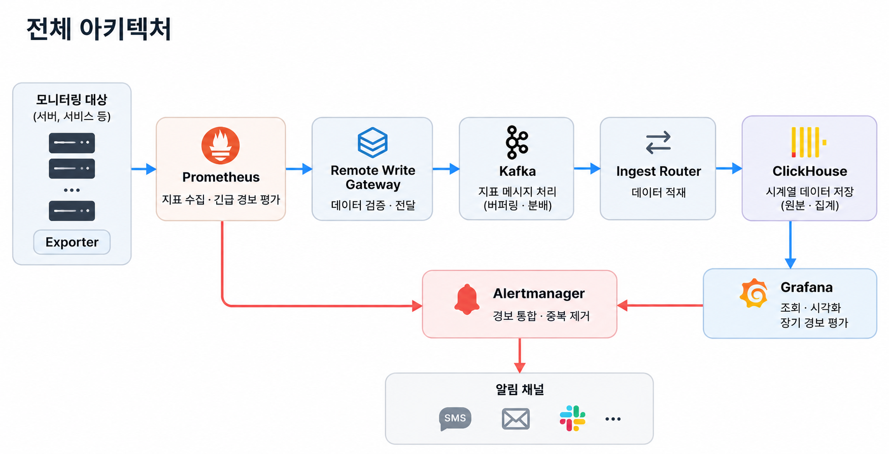

# 대규모 지표 모니터링 및 경보 시스템 설계

> 『가상 면접 사례로 배우는 대규모 시스템 설계 기초 2』 제5장  

## 1. 요구사항

| 항목 | 기준 | 구분 |
|---|---|---|
| 서버 수 | 100,000대 (1,000개 풀 × 100대) | 요구사항 |
| 서버당 지표 | 100개 | 요구사항 |
| 수집 주기 | 10초 | 요구사항 |
| 논리 시계열 / 수집률 | 1,000만 개 / 100만 samples/s | 요구사항에서 산정 |
| 피크 | 논리 300만 samples/s, 10분 지속 | 설계 결정 |
| 피크 적체 해소 | 피크 종료 후 20분 이내 | 설계 결정 |
| 보관 | 최근 7일 10초 원본, 7~30일 1분, 30일~1년 1시간 | 요구사항 |
| 기능 | 지표 수집·조회·시각화, 단기 긴급 경보, 장기·복합 경보, Email/SMS/PagerDuty/Webhook 알림 | 요구사항 |
| 제외 | 로그 수집, 분산 추적, 외부 채널의 종단 간 Exactly-once | 설계 범위 |

Prometheus는 10초 간격으로 지표를 가져오기 때문에 평소 수집량이 갑자기 몇 배로 늘어나지는 않는다. 여기서는 Remote Write 장애 후 WAL에 쌓인 데이터를 다시 보내는 상황과 수집 대상이 늘어나는 상황을 피크 원인으로 보았다. 두 상황은 Prometheus에 걸리는 부하가 다르므로 실제 테스트에서도 구분할 필요가 있다.

수집 중 일시적인 장애가 나더라도 WAL 재전송과 Kafka 버퍼링으로 복구할 수 있게 했다. HA 복제본의 샘플은 수집 단계에서 버리지 않고 저장한 뒤 조회할 때 대표 샘플을 선택한다. 긴급 경보는 Kafka나 ClickHouse 상태에 영향을 받지 않도록 Prometheus에서 직접 평가한다.

## 2. 아키텍처

| 경로 | 흐름 |
|---|---|
| 지표 데이터 | Exporter → Prometheus → Gateway → Kafka → Ingest Router → ClickHouse → Grafana |
| 긴급 경보 | Prometheus → Alertmanager → 외부 채널 |
| 장기·복합 경보 | ClickHouse → Grafana Managed Alerting → Alertmanager → 외부 채널 |

### 주요 구성요소

| 구성요소 | 초기 계획 | 역할 |
|---|---|---|
| Prometheus | 서비스 5 Shards × HA 2 = 10대, 운영 모니터링 HA 2대. 총 12대 | 서비스 지표 수집·긴급 경보·Remote Write와 파이프라인 자체 모니터링을 분리 |
| Remote Write Gateway | 14대 (무상태) | Remote Write 검증, Kafka 발행 |
| Kafka | Broker 12대 × 24TB, KRaft Controller 3대 | 버퍼링, Replay |
| Ingest Router | 10대 (무상태, Consumer Group) | Kafka → ClickHouse 적재, 샤드 매핑 |
| ClickHouse | 8 Shards × 2 Replicas = 16대 × 8TB, Keeper 3대 | 시계열 저장, Rollup |
| Grafana | 2대 + 공유 PostgreSQL (Primary + Standby) | 조회·시각화, 장기 경보 평가 |
| Alertmanager | 3대 (Gossip) | 그룹화, 중복 억제, Silence, 라우팅, 재시도 |
| SMS Gateway | 2대 (무상태) | Alertmanager Webhook → SMS 제공자 API 변환 |

## 3. 수집과 HA 중복 처리

### HA 복제본의 샘플을 모두 보관하는 이유

- 같은 Shard의 두 Replica는 동일 대상을 독립 수집하고, **둘 다** Remote Write를 보낸다.
- Gateway는 요청을 검증하고 `cluster`, `replica_id`, `series_id`, `timestamp`, `value`를 보존해 Kafka에 발행한다. **Kafka `acks=all` 성공 후에만 HTTP 2xx**를 반환한다.
- Gateway는 HA 리더를 선출하거나 샘플을 폐기하지 않는다. 따라서 리더 전환에 따른 데이터 공백이 없다.
- 그 대가로 Kafka·ClickHouse 입력량이 논리 유입량의 2배가 된다(평균 2M/s, 피크 6M/s).

### HA 대표 샘플 선택

두 Replica는 scrape 시각이 서로 달라 `(series_id, timestamp)`로는 HA 중복을 제거할 수 없다. 대신 조회·집계 시점에 **10초 슬롯 단위로 대표 샘플을 고른다**.

- `slot = floor(timestamp / 10s)`.
- 같은 `(series_id, slot)` 안에서 우선 Replica의 샘플을 선택하고, 없으면 다른 Replica로 보충한다.
- 우선순위와 tie-breaker(Replica ID → timestamp)는 결정적으로 고정한다.
- 이 로직은 ClickHouse VIEW `metrics_raw_dedup` 하나로 구현한다. **대시보드·장기 경보·Rollup 생성은 모두 이 VIEW만 조회**하고, Raw 테이블을 직접 조회하지 않는다.

**대표 샘플을 고를 때 고려한 점**
- 슬롯 대표화는 10초 해상도의 논리 샘플을 고르는 정책이며, 원본과 완전히 동등하지 않다.
- 두 scrape의 실제 시각·값이 다르므로 Counter `rate` 계산에 작은 오차가 생길 수 있다.
- scrape 시각이 슬롯 경계 근처에 걸리면, 한 Replica의 샘플이 한 슬롯에 두 개 들어가고 다음 슬롯은 비는 일이 생길 수 있다. 빈 슬롯은 다른 Replica로 보충되므로 대표 샘플은 대부분 유지된다.
- 고정밀 Prometheus 의미론이 필요한 경우에는 Replica별 연속 구간을 선택하는 HA-aware 집계로 교체한다.

복구할 수 없는 경우

- 수집 실패: 두 Replica가 모두 수집하지 못한 샘플.
- 전송 실패: 원격 전송 중단이 Prometheus WAL 보존 기간보다 길어져, 전송되지 않은 샘플이 WAL에서 삭제된 경우.

## 4. Kafka와 ClickHouse 샤드 분리

### Kafka 파티션과 ClickHouse 샤드를 분리한 이유

- Kafka는 단일 토픽 `metrics.raw`, **192 Partitions**, RF=3, `min.insync.replicas=2`, 72시간 보존을 사용한다.
- Partition key는 `series_id`의 안정적 해시다. 같은 시계열은 Replica와 무관하게 같은 Partition에 들어가므로, 두 Replica의 샘플이 항상 같은 ClickHouse Shard에 모인다. 이것이 Shard 내 대표화의 전제다.
- Ingest Router는 **Partition → Shard 매핑**(초기: 192개를 8개 Shard에 24개씩)을 참조해 해당 Shard의 로컬 테이블에 적재한다.
- Shard를 증설할 때 Kafka 토픽은 그대로 두고 매핑 버전만 바꾼다. 매핑 변경은 기존 데이터를 옮기지 않으므로, 과거 데이터 재배치(또는 epoch 기반 라우팅)와 백필 절차를 별도로 수행한다.
- 매핑 변경 시에는 대상 Partition 소비를 일시 정지하고, 마지막 커밋 Offset과 매핑 버전을 확정한 뒤 재개한다.

### 적재 정합성

- Ingest Router는 **ClickHouse Insert 성공 후에만** Kafka Offset을 커밋한다(at-least-once).
- Insert, Replica 복제, Offset Commit은 하나의 원자적 트랜잭션이 아니다. 그래서 두 가지 일이 생길 수 있다.
    - Offset 커밋 전 장애: 재소비로 중복이 적재된다. 이 중복은 Raw 중복 제거로 정리한다.
    - 한 Replica에만 Insert된 직후 그 Replica를 잃는 경우: 복제 전 데이터가 유실될 수 있다.
- `insert_quorum=2`는 사용하지 않는다. Replica가 2개뿐이라 이 설정을 쓰면 Replica 1대 장애만으로 해당 Shard의 적재가 멈춘다. 적재 가용성을 우선하고, 대신 Kafka 72시간 보존과 Offset·적재 구간 대조로 빠진 구간을 Replay한다.
- Replica를 3개로 늘리면 가용성을 잃지 않고 `insert_quorum=2`를 쓸 수 있다. 다만 저장 비용이 1.5배가 된다.

## 5. 저장과 Rollup

### Raw 테이블

- `ReplicatedReplacingMergeTree`, `ORDER BY (series_id, timestamp, replica_id)`, `PARTITION BY toDate(timestamp)`, TTL 7일.
- 컬럼: `series_id`, `replica_id`, `timestamp`, `slot`, `value`, `event_key`.
- `event_key = hash(series_id, replica_id, timestamp, value)`는 재전송 식별용이다. 같은 키의 재전송은 한 번만 사용한다. 정렬 키에 `replica_id`가 들어 있으므로, 두 Replica의 샘플이 서로 중복으로 처리되지 않는다.
- 백그라운드 Merge 완료를 정확성의 전제로 두지 않는다. `metrics_raw_dedup` VIEW가 재전송 중복 제거와 HA 대표화를 명시적으로 수행한다.
- 같은 `(series_id, replica_id, timestamp)`인데 값이 다른 충돌은 별도 검증 대상으로 기록한다.

### Rollup

- **1분 Rollup:** 지연 허용 구간(초기 가정 5분)이 지난 확정 버킷에 대해, `metrics_raw_dedup`을 입력으로 예약 쿼리를 실행해 생성한다. 저장 값은 `count`, `sum`, `min`, `max`와 필요한 집계 상태다.
- **1시간 Rollup:** 확정된 1분 Rollup에서 생성한다.
- Kafka Engine → Materialized View로 들어오는 원본을 곧바로 누적하는 방식은 쓰지 않는다. 중복이 집계에 그대로 반영되기 때문이다.
- 지연 도착이나 Replay로 확정 버킷이 바뀌면 해당 버킷을 다시 계산해 **파티션 단위로 교체**한다(예: `REPLACE PARTITION`). 기존 집계에 값을 더하지 않는다. 구체적인 DDL과 교체 절차는 구현 단계에서 검증한다.
- Raw TTL로 원본이 지워지기 전에 대상 Rollup의 확정·검증을 마친다. 원본이 사라진 구간(7일 이후)을 정정하려면 백업이 필요하다.
- 최신의 미확정 구간은 대시보드에서 `metrics_raw_dedup`으로 조회한다.

### 보관 정책

| 데이터 나이 | 제공 해상도 | 물리 보관 |
|---|---|---|
| 0~7일 | 10초 원본 | Raw 7일 (두 HA Replica 원본 보존) |
| 7~30일 | 1분 집계 | 1분 Rollup 30일 |
| 30일~1년 | 1시간 집계 | 1시간 Rollup 365일. 30일 초과분은 객체 스토리지 계층 |

객체 스토리지 계층은 ClickHouse 스토리지 정책(디스크·볼륨 설정)으로 구성해야 조회할 수 있다. 별도 설정 없이 자동으로 조회되지 않는다.

### 백업

- ClickHouse 테이블을 객체 스토리지로 백업한다. 일 1회 증분, 주 1회 전체를 초기 기준으로 잡았다.
- Kafka 72시간 이전 구간의 복구는 백업에 의존한다.

## 6. 용량 산정

아래 수치는 부하 테스트로 확인한 값이 아니다. 처리량과 압축 크기를 가정해 처음 필요한 규모를 계산했다.

### 처리량

서비스 지표는 5개 샤드에 균등하게 나눈다. 한 샤드는 서버 약 2만 대, 활성 시계열 약 200만 개를 맡는다. 각 샤드의 HA 복제본은 동일한 대상을 수집하므로 한 인스턴스당 평균 20만 samples/s를 처리한다. 10대 구성은 이 수치를 감당할 수 있다는 성능 보증이 아니라 초기 배치안이다. 특히 수집 대상이 실제로 3배 증가하는 피크라면 한 인스턴스당 60만 samples/s가 필요하므로 부하 테스트가 선행되어야 한다. WAL 재전송으로 생긴 피크라면 scrape 부하가 아닌 Remote Write 부하를 별도로 측정한다.

| 계층 | 입력 (평균 / 피크) | 인스턴스당 가정 | 필요 대수 | 계획 대수 |
|---|---|---|---:|---:|
| Prometheus (서비스) | 200K / 600K samples/s (Replica당, 논리 수집 피크 3배 가정) | 실측 필요 | 5 Shards × HA 2 | **10** |
| Prometheus (운영 모니터링) | 별도 소규모 수집 부하 | 실측 필요 | HA 2 | **2** |
| Gateway | 2M / 6M samples/s | 500K/s | 12 | **14** (1대 장애 시 13 × 500K = 6.5M/s) |
| Ingest Router | 최대 4M samples/s (적체 해소 시) | 500K/s | 8 | **10** (1대 장애 시 9 × 500K = 4.5M/s) |
| ClickHouse | 최대 4M samples/s (적체 해소 시) | Shard당 500K/s | 8 Shards | **8 Shards × 2** |

### 피크 적체

- 보수적으로 피크 중에도 소비가 정상 수준(2M/s)에 머문다고 가정하면, 적체는 `(6M − 2M) × 600초 = 24억 samples`다.
- 피크 종료 후 20분 안에 이를 해소하려면 소비량이 **4M/s 이상**이어야 한다(정상 2M/s + 적체 해소 2M/s).
- ClickHouse 8 Shard의 이론 처리량 4M/s는 이 조건을 충족한다. 피크 중에도 4M/s로 소비되면 적체는 `(6M − 4M) × 600초 = 12억`으로 줄고, 약 10분 만에 해소된다.
- 4M/s는 Merge·조회 부하를 제외한 이론값이다.

### Kafka 디스크

- 평균 2M samples/s × 100B × 86,400초 × 3일 = **51.84TB** (논리).
- RF=3 반영 **155.52TB**. 사용률 상한 70% 기준 **약 222.2TB** 물리 용량이 필요하다.
- Broker 12대 기준 대당 최소 약 18.5TB → **대당 24TB**로 계획한다(총 288TB, 사용률 약 54%, 1대 장애 시 약 59%).
- 100B/샘플은 가정이며 라벨 길이·압축·프로토콜 오버헤드에 따라 달라진다.

### ClickHouse 디스크

| 테이블 | 보관 | 행 수 | 행당 압축 크기 (가정) | 논리 용량 | 2 Replica |
|---|---|---:|---:|---:|---:|
| Raw (HA 2배) | 7일 | 2M × 86,400 × 7 ≈ 1조 2,096억 | 16B | 19.35TB | 38.71TB |
| 1분 Rollup | 30일 | 1,000만 × 1,440 × 30 ≈ 4,320억 | 32B | 13.82TB | 27.65TB |
| 1시간 Rollup (로컬 30일분) | 30일 | 1,000만 × 24 × 30 ≈ 72억 | 32B | 0.23TB | 0.46TB |
| 1시간 Rollup (전체) | 365일 | 1,000만 × 24 × 365 ≈ 876억 | 32B | 2.80TB | 5.61TB (30일 초과분은 객체 스토리지) |

- 로컬 계층 합계: 38.71 + 27.65 + 0.46 ≈ **66.8TB**.
- 사용률 상한 70% 기준 **약 95.5TB** 필요 → 16대 기준 대당 최소 약 6TB.
- **대당 8TB**로 계획한다(총 128TB, 사용률 약 52%). Merge 임시 공간과 Replay 중 중복 행을 위한 여유를 포함한다.
- Rollup 행 수는 모든 버킷에 모든 시계열이 존재한다는 상한 가정이다.

## 7. 경보 평가

### 실시간 및 장기 경보 처리

**긴급 경보 (Prometheus)**
- 각 Prometheus가 자기 Shard 대상에 대한 CPU·메모리·가용성 규칙을 평가해 Alertmanager로 보낸다.
- `alert_relabel_configs`로 Replica 라벨을 제거한다. 그래야 두 Replica의 경보가 같은 fingerprint가 되어 Alertmanager에서 하나로 묶인다.
- 단일 Shard 데이터만으로 평가할 수 있는 규칙만 둔다. 여러 Shard를 합쳐야 하는 규칙은 Grafana로 보낸다.
- Kafka·ClickHouse가 중단돼도 이 경로는 동작한다.

**파이프라인 자체 모니터링**
- 서비스 지표 수집용 5개 Shard(HA 10대)와 별개로 인프라 모니터링용 Prometheus 2대를 둔다. Gateway, Kafka, Ingest Router, ClickHouse, Grafana, Alertmanager, SMS Gateway의 exporter를 수집한다.
- 운영 모니터링 Prometheus의 경보도 Prometheus에서 직접 평가하므로 데이터 경로 장애와 무관하게 동작한다.

**장기·복합 경보 (Grafana)**
- Grafana가 ClickHouse 데이터 소스(`metrics_raw_dedup` 및 Rollup)를 조회해 긴 시간창·여러 Shard 조건을 평가하고, 외부 Alertmanager로 보낸다.
- Grafana HA 2대는 공유 PostgreSQL에 대시보드·경보 규칙·상태를 저장한다. 이 DB는 Grafana 운영 상태 저장용이며 알림 작업 큐가 아니다.
- HA 인스턴스가 같은 경보를 중복 전송하면 Alertmanager가 fingerprint로 억제한다.
- 데이터 신선도 조건을 별도 경보로 두고, 조회 실패와 데이터 없음(No Data)을 정상으로 취급하지 않는다.
- Grafana가 장기 경보를 평가할 수 있도록 SQL과 평가 주기를 설계했지만, 실제 쿼리 실행 시간과 HA 동작은 구축 후 확인해야 한다.

## 8. 알림 전달

### Alertmanager에서 알림을 보내는 방식

- Alertmanager 3대(Gossip)가 Prometheus와 Grafana의 경보를 받아 그룹화, 중복 억제, Silence, Inhibition, 반복 전송, 재시도를 담당한다.
- 초기 설정: `group_wait=30s`, `group_interval=5m`, `repeat_interval=4h`. 긴급 경보 route는 `group_wait`를 짧게 둔다.
- PagerDuty, Email, Webhook은 Alertmanager 기본 연동으로 전송한다.
- SMS는 **SMS Gateway**(무상태 2대)를 거친다. Alertmanager Webhook을 받아 SMS 제공자 API로 변환하고, 제공자 응답을 받은 뒤 2xx를 반환한다.
- P0 경보는 PagerDuty receiver 하나로만 보낸다. 다른 채널은 별도 receiver로 둔다. PagerDuty 연동을 여러 route에 중복 구성하지 않는다. route마다 `groupKey`가 달라 PagerDuty에서 중복 Incident가 생기기 때문이다.
- Gossip은 강한 일관성이 아니므로 네트워크 분리 시 중복 알림이 발생할 수 있다.

**알림 경로 자체의 장애 감지:** 알림 전달이 Alertmanager 하나에 의존하므로, 항상 Firing 상태인 Watchdog 경보를 외부 Dead Man's Switch 서비스로 주기 전송한다. 일정 시간 수신이 없으면 외부 서비스가 직접 담당자를 호출한다.

별도 알림 큐를 두지 않았으므로 채널별 전달 이력을 한곳에 보관하거나 외부 전송을 정확히 한 번만 수행한다고 보장하지는 않는다. 이번 요구사항에서는 Alertmanager의 재시도와 외부 Watchdog을 우선 사용한다.

## 9. 조회·시각화

- Grafana의 ClickHouse 데이터 소스로 직접 조회한다.
- 패널은 시간 범위에 따라 `metrics_raw_dedup` / 1분 Rollup / 1시간 Rollup 중 하나를 조회하도록 명시적으로 작성한다.
- ClickHouse 읽기 전용 계정, 쿼리 시간 제한, 반환 포인트 수 제한, 동시성 제한을 적용한다.
- PromQL 호환은 제공하지 않는다. 쿼리는 ClickHouse SQL로 작성한다.

## 10. 장애 대응

| 상황 | 대응 | 보장 범위 |
|---|---|---|
| Prometheus Replica 1대 | 다른 Replica가 계속 수집, 두 Replica 모두 Raw에 저장 | 수집 지속. 두 Replica 모두 수집하지 못한 구간은 복구 불가 |
| Gateway 1대 | 로드밸런서 우회, Prometheus WAL 재전송 | WAL 보존 기간 내 복구. 13대로 피크 6M/s 수용 |
| Kafka Broker 1대 | RF3, `acks=all`, ISR Leader 전환 | `min.insync.replicas=2` 조건에서 확인된 쓰기 유실 없음 |
| Ingest Router 1대 | Consumer Group 재할당, 커밋 Offset 이후 재처리 | At-least-once. 재전송 중복은 Raw 단계에서 정리 |
| ClickHouse Replica 1대 | 정상 Replica로 조회·적재, Offset·적재 구간 대조 후 Replay | 복제 전 유실 구간 가능, 72시간 이내면 Replay로 보완 |
| ClickHouse Shard 전체 | 백업 복원 후 해당 Partition들 Offset 재설정·Replay | 최근 72시간은 Kafka로, 그 이전은 백업 시점까지 복구 |
| Rollup 오염·지연 | 확정 버킷 재계산 후 파티션 교체, 최신 구간은 Raw 조회 | 7일 이후 구간 정정은 백업 필요 |
| Grafana 1대 | 다른 인스턴스가 평가·조회 | 장기 경보 평가 일시 지연 가능. 긴급 경보는 독립 |
| Grafana 공유 DB | Standby 승격 | 승격 중 장기 경보 평가·대시보드 편집 지연 |
| Alertmanager 1대 | 다른 Peer가 처리 | 네트워크 분리 시 중복 알림 가능 |
| Alertmanager 전체 | Dead Man's Switch가 외부에서 호출 | 경보 전달 중단을 외부에서 감지 |

### 관측 지표

| 구성요소 | 지표 |
|---|---|
| Prometheus | Scrape 실패율, Remote Write Pending·Failures, WAL 크기 |
| Gateway | 처리량, 오류율, Kafka Produce Latency |
| Kafka | Consumer Lag, ISR, Under-replicated Partitions, 디스크 |
| Ingest Router | 커밋 Offset, 재처리 건수, Insert 지연 |
| ClickHouse | 적재 시간 범위, 복제 지연, Merge Backlog, 중복 키 비율, Raw↔Rollup 대조 결과 |
| Grafana | 경보 평가 실패, No Data 발생 |
| Alertmanager | 전송 실패율, Peer 상태 |
| SMS Gateway | 제공자 API 오류율, 지연 |

## 11. 기술 선택과 트레이드오프

| 선택 | 이점 | 비용·한계 |
|---|---|---|
| HA 두 Replica 모두 저장 | 리더 전환에 따른 데이터 공백 없음 | Kafka·ClickHouse 처리량·저장 2배 |
| 슬롯 대표화 VIEW | 조회·집계 로직 일원화 | Counter `rate`에 작은 오차, 조회 비용 증가 |
| 확정 Rollup 배치 생성 | 중복이 집계에 반영되지 않음 | 수분 수준의 집계 확정 지연 |
| Partition → Shard 매핑 | Kafka 구조를 유지한 채 Shard 증설 | 과거 데이터 재배치 절차 필요 |
| `insert_quorum` 미사용 | Replica 1대 장애에도 적재 지속 | 복제 전 유실 구간 가능, 대조·Replay 필요 |
| Grafana Managed Alerting | 별도 평가 서비스 없음 | SQL 표현력·HA 동작 검증 필요, 공유 DB 의존 |
| Alertmanager 직접 전송 | 구성요소 최소화 | 영속 전달 큐·통합 전달 이력 없음 |

## 12. 설계하면서 확인할 부분

- 보관 정책(최근 7일 원본, 7~30일 1분, 30일~1년 1시간)은 교재 기반 요구사항이다.
- 노드 수, 인스턴스당 처리량, Partition 수, 샘플·행 크기, 지연 허용 구간은 초기 설계 가정이다.
- 슬롯 대표화의 정확성, Rollup 파티션 교체 절차, Grafana 장기 경보의 HA 동작, 적재 처리량은 구현 단계에서 검증해야 한다.

## 13. 정리

지표는 **Prometheus → Gateway → Kafka → Ingest Router → ClickHouse → Grafana**로 흐르고, 경보는 **Prometheus(긴급)·Grafana(장기·복합) → Alertmanager → 외부 채널**로 전달된다. HA 두 Replica의 샘플을 모두 저장해 한쪽 Replica의 데이터를 미리 버리지 않고, 조회·집계 단계에서 슬롯 단위로 대표화한다. Raw 적재와 Rollup 확정을 분리해 중복이 집계에 반영되지 않게 하고, Kafka Partition과 ClickHouse Shard를 매핑으로 분리해 확장에 대비한다. 별도의 평가 서비스와 알림 큐 없이 Prometheus·Grafana·Alertmanager의 기본 기능으로 경보를 처리한다.