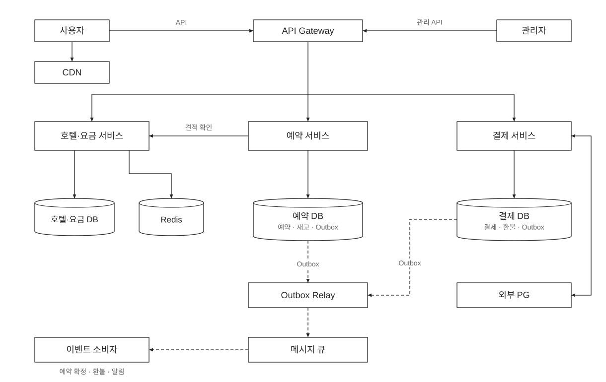
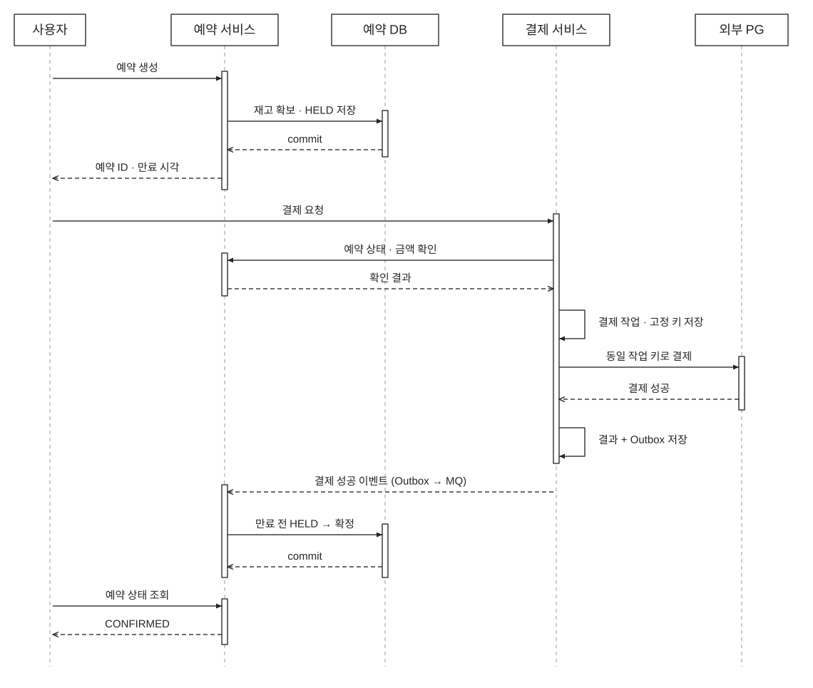

# 호텔 예약 시스템


## 1. 도메인 배경 및 핵심 개념

호텔 예약에서는 특정 객실 번호보다 **객실 유형과 숙박일별 판매 가능 수량**이 중요하다. 사용자는 특정 호텔의 디럭스룸을 예약하고, 실제 객실 번호는 체크인 때 배정받는다고 본다.

| 개념 | 의미 |
| --- | --- |
| 호텔 / 객실 유형 | 어느 호텔의 어떤 유형을 예약하는지 구분한다. |
| 날짜별 재고 | `호텔 + 객실 유형 + 숙박일`마다 판매 가능한 객실 수를 관리한다. |
| 날짜별 요금 | 같은 객실 유형도 숙박일마다 요금이 다를 수 있다. |
| 임시 확보(Hold) | 결제하는 동안 다른 사용자에게 판매되지 않도록 재고를 잠시 확보한다. |
| 예약 확정 | 유효한 임시 확보에 결제 성공을 반영한 상태다. |
| 만료 / 취소 | 임시 확보 또는 확정 예약을 해제하고 재고를 반환한다. 결제된 금액은 별도로 환불한다. |
| 멱등성 | 같은 예약·결제 작업을 재시도해도 재고 차감이나 청구가 반복되지 않는 성질이다. |

숙박일은 **체크인 날짜 이상, 체크아웃 날짜 미만**으로 계산한다. 예를 들어 11월 20일 체크인, 23일 체크아웃이면 20·21·22일의 재고가 모두 필요하다. 하루라도 부족하면 전체 예약을 실패시킨다. 숙박 날짜는 호텔의 현지 날짜로 관리하고, 임시 확보 만료 시각은 UTC 기준의 절대 시각으로 저장한다.

3박 예약 1건을 받으려면 **세 날짜 모두 객실이 1개씩 남아 있어야 한다.** 첫날 3개, 둘째 날 1개, 셋째 날 2개가 남았다면 3박 예약은 1건만 받을 수 있다. 2건을 받으면 둘째 날 객실이 부족해지기 때문이다. 따라서 예약 가능한 수량은 가장 적게 남은 날을 기준으로 정한다.

## 2. 요구사항 및 설계 범위

### 기능적 요구사항

- 호텔과 객실 유형, 날짜별 요금과 예약 가능 여부를 조회한다.
- 숙박일과 객실 수를 선택해 예약하고 결제한다.
- 본인의 예약 상태를 조회하고 예약을 취소한다.
- 관리자는 호텔·객실 정보, 판매 재고와 요금을 관리한다.

### 비기능적 요구사항

- 조회 응답은 빠르게 제공하고, 예약에서는 재고와 결제의 정확성을 우선한다.
- 동시 요청과 재시도가 발생해도 초과 판매와 중복 청구를 방지한다.
- 기존 예약의 결제·조회·취소를 안정적으로 처리할 수 있어야 한다.

### 설계 가정

호텔 체인의 웹·앱에서 직접 예약하며, 예약할 때 결제하는 상황을 다룬다. 한 예약은 한 호텔의 한 객실 유형을 대상으로 하고, 객실 유형 안에서는 객실을 서로 대체할 수 있다고 가정한다. 의도적인 오버부킹은 허용하지 않는다. 외부 예약 플랫폼과의 재고 동기화, 실제 객실 배정, 복잡한 취소 수수료 정책은 범위에서 제외하고 취소 시 전액 환불을 가정한다. 임시 확보의 유효 시간은 결제에 필요한 짧은 시간으로 두고, 구체적인 값은 운영 정책으로 정한다.

## 3. 아키텍처 설계도

### 전체 구조



그림의 서비스는 책임을 나누는 단위다. 초기에는 일부를 하나의 애플리케이션으로 배포할 수 있다. **예약과 재고는 같은 서비스가 소유하고, 같은 관계형 DB(RDB)의 트랜잭션으로 변경한다.**

| 구성 요소 | 역할 |
| --- | --- |
| CDN | 호텔 사진과 정적 파일을 제공한다. |
| API Gateway | 인증, 라우팅, 기본적인 요청 제한을 처리한다. 관리자 요청에는 별도의 권한 검사를 적용한다. |
| 호텔·요금 서비스 | 호텔·객실 정보를 조회하고 날짜별 요금을 계산한다. 관리자의 정보·요금 변경도 처리한다. |
| Redis 캐시 | 호텔 소개 등 반복 조회가 많은 데이터를 캐싱한다. |
| 예약 서비스 | 예약 가능 여부 조회, 재고 임시 확보, 예약 확정·만료·취소, 관리자의 판매 재고 변경을 처리한다. |
| 결제 서비스 | 외부 PG 연동과 결제·환불 상태를 관리한다. |
| RDB | 호텔·요금 데이터, 예약·재고 데이터, 결제 데이터를 각 소유 영역에 저장한다. |
| Outbox Relay / 메시지 큐 | 각 서비스의 DB에 저장한 이벤트를 전달한다. 결제 결과 반영, 환불 요청, 예약 알림에 사용한다. |
| 만료·대조 Worker | 만료된 임시 확보를 정리하고, 처리 중인 결제와 PG 상태의 불일치를 확인한다. 상태 변경은 해당 소유 서비스의 로직으로 처리한다. |

기본 배치는 단일 리전의 여러 가용 영역으로 잡는다. API 서버와 Worker는 여러 인스턴스로 구성하고, 예약·결제 DB 각각은 하나의 메인 DB와 동기 복제 DB를 둔다. 변경 내용을 복제 DB에도 저장한 것을 확인한 뒤 사용자에게 성공을 응답한다.

메인 DB가 고장 나면, **이미 성공으로 응답한 데이터가 모두 저장돼 있는 복제 DB를 새 메인 DB로 사용한다.** 이때 기존 메인 DB의 쓰기를 막아 두 DB가 동시에 데이터를 변경하지 않게 한다. 성공한 데이터가 복제 DB에 모두 남아 있는지 확인할 수 없으면 쓰기를 잠시 중단한다. 최종 재고 판단과 예약 직후 상태 조회는 메인 DB에서 처리한다.

복제본은 지연을 허용할 수 있는 조회에 활용한다. 동기 복제는 커밋 지연과 일부 장애 시 쓰기 가용성 저하를 감수하는 선택이다. 리전 전체 손실까지 같은 보장을 하려면 별도의 재해 복구 설계가 필요하다.

### 주요 API

| API 예시 | 설명 |
| --- | --- |
| `GET /hotels/{hotel_id}` | 호텔과 객실 유형 정보 조회 |
| `GET /hotels/{hotel_id}/availability` | 숙박 기간의 객실 유형별 가용 재고와 요금 조회 |
| `POST /quotes` | 숙박 조건의 금액·유효 시간이 담긴 `quote_id`와 예약 요청용 멱등성 키 발급 |
| `POST /reservations` | 숙박 조건과 `quote_id`로 재고를 임시 확보하고 예약 생성 |
| `POST /reservations/{reservation_id}/payments` | 예약에 대한 결제 작업 시작 또는 재시도 |
| `GET /reservations/{reservation_id}` | 본인 예약과 결제 상태 조회 |
| `GET /reservation-requests/{request_key}` | 응답을 받지 못했을 때 본인의 멱등성 키로 기존 예약 확인 |
| `POST /reservations/{reservation_id}/cancel` | 본인 예약 취소 |

서버는 예약 요청 전에 견적을 발급할 때 **예약 요청 한 건을 식별하는 UUID v4**를 함께 발급한다. 예를 들어 `550e8400-e29b-41d4-a716-446655440000` 같은 값이다. 클라이언트는 이 값을 보관했다가 예약 생성 요청의 `Idempotency-Key` 헤더에 넣는다.

```http
POST /reservations
Idempotency-Key: 550e8400-e29b-41d4-a716-446655440000
```

응답이 없어 같은 예약을 재시도할 때는 **기존 키를 그대로 사용한다.** 같은 사용자·호텔·날짜·객실 조건이어도 별도의 예약을 추가하는 경우에는 새 키를 발급받는다. 서버는 같은 사용자의 동일 키 재요청에 기존 예약을 반환하고, 같은 키로 숙박 조건을 바꾸면 충돌로 처리한다. 결제·환불에는 각각 서버가 저장한 별도의 작업 키를 사용하며, 동일 작업의 재시도에 같은 값을 사용한다. 프런트엔드의 버튼 비활성화와 별개로 서버에서 보장해야 한다.

예약 커밋 후 응답만 유실될 수 있으므로 타임아웃을 예약 실패로 단정하지 않는다. 사용자는 같은 키로 재시도하거나 요청 조회 API로 결과를 확인한다. 요청 조회는 견적이 만료돼도 본인 인증으로 가능하다. 아직 조회되지 않는 요청은 진행 중일 수도 있으므로 새 키로 다시 생성하지 않는다. 성공한 키와 예약의 연결은 취소·만료 후에도 유지하고, 보관 데이터로 옮길 때도 중복 여부를 확인할 수 있게 한다.

조회 화면의 금액을 그대로 신뢰하지 않는다. 서버가 계산한 견적의 호텔·객실 유형·숙박일·객실 수와 할인 자격이 요청에 맞는지 확인하고, 재고 확보 직전에 견적 유효 시간을 다시 검사한다. 임시 확보 시점에 숙박일별 요금·총액·통화를 예약에 저장하며, 이후 요금이 바뀌어도 해당 예약의 결제 금액은 저장한 값을 따른다. 견적 발급 자체는 재고 확보를 의미하지 않는다.

### 핵심 데이터 모델

| 데이터 | 주요 필드와 역할 |
| --- | --- |
| `hotel` / `room_type` | 호텔 정보와 객실 유형 정보 |
| `room_type_rate` / `price_quote` | 호텔·객실 유형·숙박일별 요금, 견적 금액과 유효 시간 |
| `room_type_inventory` | `hotel_id`, `room_type_id`, `stay_date`, `total_count`, `held_count`, `booked_count` |
| `reservation` | 사용자, 호텔·객실 유형, 체크인·체크아웃, 객실 수, 확정 금액·통화, 상태, 만료 시각, 멱등성 키, 요청 내용 해시 |
| `payment` / `payment_attempt` | 예약별 결제 관리 행과 각 시도의 작업 키, PG 거래 ID, 금액·통화, 상태. 현재 처리 중인 시도를 구분한다. |
| `refund` | 환불 대상 PG 거래, 고정 환불 작업 키, 환불 금액과 처리 상태 |
| `outbox` | 이벤트 ID, 종류, 관련 예약·결제 작업 ID, 전송 상태, 업무 변경과 같은 트랜잭션으로 저장한다. |
| `processed_event` | `(consumer_id, event_id)` 유니크 제약으로 중복을 차단한다. 업무 상태 변경과 같은 트랜잭션으로 기록한다. |

`room_type_inventory`의 기본키는 `(hotel_id, room_type_id, stay_date)`다. 판매 대상 날짜의 행을 미리 생성하며, 필요한 날짜 행이 없으면 예약 가능으로 판단하지 않는다.

```text
가용 재고 = total_count - held_count - booked_count

held_count >= 0
booked_count >= 0
held_count + booked_count <= total_count
```

위 조건은 DB의 `CHECK` 제약조건으로도 방어하고, 수량 필드는 `NOT NULL`로 둔다. 요청 객실 수는 양의 정수, 체크아웃은 체크인 이후여야 한다. `reservation`에는 `(user_id, idempotency_key)` 유니크 제약을 둔다. 관리자가 판매 수량을 줄일 때도 같은 재고 행을 잠그고, 이미 확보·확정된 수량보다 작게 변경할 수 없게 한다.

### 재고 임시 확보와 동시성 제어

두 사용자가 마지막 객실을 동시에 조회하면 둘 다 “예약 가능”을 볼 수 있다. 따라서 **조회 결과와 별개로 예약 트랜잭션 안에서 재고를 다시 확인한다.**

예약 서비스는 견적을 확인한 뒤 아래 작업을 하나의 트랜잭션으로 수행한다. 같은 키의 재요청이면 견적의 현재 유효 시간보다 기존 예약 조회를 먼저 처리한다.

1. 멱등성 키를 가진 예약 레코드를 생성한다. 중복 키면 이번 트랜잭션을 종료하고 기존 예약을 반환한다. 중복 요청에서 재고가 추가로 확보되지 않아야 한다.
2. 숙박 기간에 해당하는 재고 행을 날짜 순으로 잠근다.
3. 필요한 날짜의 행이 모두 있고, 모든 날짜에 요청한 객실 수만큼 여유가 있는지 확인한다.
4. 잠금 대기 중 견적이 만료되지 않았는지 검사한 뒤 모든 날짜의 `held_count`를 증가시킨다. 예약을 `HELD` 상태로 저장하고, DB 현재 시각을 기준으로 만료 시각을 정한다. 예약 금액도 함께 기록한다.
5. 후속 이벤트를 outbox에 저장하고 커밋한다. 중간에 실패하면 예약 생성과 모든 날짜의 재고 변경을 롤백한다.

핵심 잠금 조회의 SQL 예시는 다음과 같다. 이 조회와 검증·갱신은 반드시 같은 트랜잭션 안에 있어야 한다. 실제 문법과 잠금 동작은 선택한 RDB에 맞춰 확인한다.

```sql
SELECT stay_date, total_count, held_count, booked_count
FROM room_type_inventory
WHERE hotel_id = :hotel_id
  AND room_type_id = :room_type_id
  AND stay_date >= :check_in
  AND stay_date < :check_out
ORDER BY stay_date
FOR UPDATE;
```

여기서는 RDB의 행 잠금을 사용하는 비관적 락을 선택한다. 같은 재고를 변경하는 트랜잭션은 앞선 변경이 끝난 뒤 최신 재고를 확인한다. 확정·만료·취소는 예약 행을 먼저 잠그고, 재고 행은 날짜 순으로 잠그는 규칙을 공유한다. 관리 작업을 포함한 모든 재고 변경 경로에 같은 규칙을 적용한다. 잠금 순서와 범위는 선택한 DB의 실행 계획으로 확인하고, 잠금 대기 초과·교착 상태·직렬화 실패는 트랜잭션 전체를 제한적으로 재시도한다.

**DB 잠금은 재고를 갱신하는 짧은 시간 동안만 유지한다. 결제하는 시간 전체에 걸쳐 유지하지 않는다.** 견적 조회·PG 호출 등 외부 네트워크 작업은 재고 트랜잭션 밖에서 수행한다. 결제 중 재고가 보호되는 이유는 잠금이 계속 잡혀 있어서가 아니라, 커밋된 `held_count`에 해당 수량이 포함되어 있기 때문이다.

### 예약·결제·확정 흐름



1. 사용자가 예약을 요청하면 예약 서비스가 재고를 임시 확보하고 `reservation_id`, 만료 시각을 반환한다. 이 단계는 예약 확정 전이다.
2. 사용자가 결제를 요청하면 결제 서비스가 예약 서비스에서 소유자·금액·현재 상태를 확인한다. 결제 작업과 PG에 사용할 고정 작업 키를 먼저 커밋한 뒤 PG를 호출한다.
3. 결제 서비스는 PG 응답이나 서명을 검증한 웹훅으로 결제 결과를 확인한다. PG 거래와 내부 결제 작업의 연결, 금액·통화가 맞는지 검사한 뒤 결과와 outbox 이벤트를 함께 저장한다. 웹훅에는 이 저장이 끝난 뒤 수신 성공을 응답한다. 이벤트 순서가 뒤바뀌거나 결과가 모호하면 PG의 현재 상태를 조회한다.
4. 결제 성공 이벤트를 받은 예약 서비스는 예약과 해당 재고 행을 잠근다. 예약에 저장된 금액·통화 및 결제 작업을 대조하고, 상태 전이 시점의 DB 현재 시각으로 아직 유효한 `HELD`인지 검사한다. 유효하면 `held_count`를 감소시키고 `booked_count`를 증가시키면서 `CONFIRMED`로 변경한다. 처리한 이벤트 ID와 확정 이벤트도 같은 트랜잭션에 저장한다.
5. 사용자는 예약 조회 API로 최종 상태를 확인한다. 결제 성공만 확인되고 확정 이벤트가 아직 처리 중이면 “예약 확인 중”으로 보여준다.

결제 DB에는 `reservation_id`가 유일한 결제 관리 행을 두고, 이 행을 잠근 짧은 트랜잭션에서 기존 시도를 확인하거나 새 시도를 생성한다. 따라서 다른 서버에 서로 다른 키로 요청이 들어와도 진행 중인 시도는 하나만 생긴다. 외부 PG를 호출하는 동안 이 잠금은 유지하지 않는다.

기존 시도가 처리 중이거나 결과가 불명확하면 그 작업을 조회한다. 이미 성공한 예약에는 추가 청구를 시작하지 않으며, 새 시도는 이전 시도의 최종 실패와 예약의 유효성을 확인한 뒤에만 허용한다. 같은 시도의 재호출에는 서버에 저장한 같은 PG 작업 키를 사용한다. PG가 같은 결제·환불 작업의 중복 실행을 막고, 작업 참조로 결과를 조회할 수 있다는 연동 조건이 필요하다.

PG 처리 직후 서버가 종료되어 결과를 저장하지 못해도 미완료 결제 작업이 DB에 남는다. 대조 Worker가 해당 작업을 조회해 결과를 복구한다. PG의 멱등성 키 보관 기간이 지난 불명확한 결제·환불 작업은 같은 키로도 중복 방지를 보장할 수 없으므로, 외부 실행을 반복하지 않고 PG 조회·운영 대조로 해결한다. 전액 환불은 대상 PG 거래에 유니크 제약을 둔 하나의 환불 작업으로 기록하고 고정 키로 재시도한다.

예약 상태와 결제 상태는 따로 관리한다.

```text
예약: HELD → CONFIRMED → CANCELED
       ├──→ EXPIRED
       └──→ CANCELED

결제: 처리 중 → 성공 / 확정된 실패 / 결과 확인 필요
      성공 → 환불 대기 → 환불 완료
```

예약 DB와 결제 DB는 각 서비스가 따로 관리하고, PG는 외부 API로 호출한다. **우리 DB에서 롤백해도 PG에서 이미 성공한 결제가 함께 취소되지는 않는다.** 또한 PG 응답을 기다리는 동안 재고의 DB 잠금을 잡아 두면 다른 예약이 오래 대기하게 된다. 그래서 각 서비스의 DB 작업은 짧은 트랜잭션으로 처리하고, 재전달 가능한 이벤트로 상태를 맞춘다. 이미 결제했지만 예약을 확정할 수 없으면 별도의 환불 요청으로 보상한다.

### Outbox 전달과 재처리 경계

DB 커밋 직후 서버가 종료되어도 이벤트를 다시 보낼 수 있도록 **상태 변경과 outbox 저장을 함께 커밋**한다. Relay는 각 소유 DB의 미전송 이벤트를 읽어 큐에 발행한다. 여러 Relay를 실행할 때는 처리 대상을 짧게 선점하고, 중단된 Relay의 작업은 선점 기한 이후 재처리한다.

| 중단 지점 | 복구 방식 |
| --- | --- |
| 업무 DB 커밋 후, 큐 발행 전 | Outbox에 남은 이벤트를 다시 발행한다. |
| 큐 저장 성공 후, Outbox 전송 완료 표시 전 | 같은 이벤트가 다시 발행될 수 있다. 큐의 내구성 있는 저장 확인을 받은 뒤에만 전송 완료로 표시한다. |
| 소비자의 업무 DB 커밋 전 | 이벤트가 재전달되면 업무 처리를 다시 수행한다. |
| 소비자의 업무 DB 커밋 후, 큐 처리 완료 응답 전 | 업무 변경과 함께 저장한 `processed_event`를 확인해 중복 효과를 막고 완료 응답한다. |

소비자는 **업무 변경·이벤트 처리 기록·후속 outbox를 함께 커밋한 뒤** 큐에 처리 완료를 알린다. 이벤트 ID가 달라도 같은 결제 성공을 중복 통지할 수 있으므로, 결제·환불 작업 ID와 허용된 상태 전이도 함께 검사한다. 성공 뒤 늦게 온 실패 이벤트가 상태를 되돌리게 하지 않는다. 순서를 판단할 수 없는 결과는 원본 상태를 조회해 대조한다.

환불 소비자는 먼저 환불 작업을 DB에 저장하고 PG 호출을 수행한다. 외부 호출의 중복 방지는 그 환불 작업의 고정 PG 키로 보장한다. 알림도 예약 확정·취소 이벤트를 소비하는 별도 작업으로 처리하며, 알림 실패 때문에 예약 트랜잭션을 되돌리지 않는다.

큐의 재전달·실패 큐 재처리 기간보다 중복 처리 기록을 먼저 삭제하지 않는다. 전송 완료된 outbox는 복구에 필요한 기간 보관 후 정리하고, 미전송 outbox와 실패 큐는 용량·최장 지연을 감시한다. 복구가 지연되어 저장 한도에 가까워지면 신규 예약을 제한한다.

### 만료·취소·결제 지연 처리

| 상황 | 처리 |
| --- | --- |
| 임시 확보 시간이 지남 | 만료 Worker가 예약을 잠그고 만료 시각과 `HELD` 상태를 다시 검사한다. `EXPIRED` 변경과 모든 숙박일의 `held_count` 감소를 함께 커밋한다. |
| 결제 성공과 만료가 동시에 처리됨 | 같은 예약 행의 잠금으로 순서를 정하고, 필요한 잠금을 얻은 뒤 상태 전이 시점의 DB 시각으로 판단한다. 만료 이후에는 Worker가 아직 실행되지 않았더라도 확정할 수 없다. |
| 만료 후 결제 성공이 확인됨 | 예약을 다시 살리지 않는다. 아직 `HELD`라면 먼저 만료·반환하고, 환불 요청을 outbox에 남긴다. 이미 반환된 재고를 다시 감소시키지 않는다. |
| PG 호출이 타임아웃됨 | 결제 실패로 단정하지 않고 결과 확인 대상으로 둔다. PG 거래 ID나 작업 참조로 조회하고, 재시도에는 같은 작업 키를 사용한다. 임시 확보는 원래 만료 정책을 따른다. |
| 결제의 최종 실패가 확인됨 | 임시 확보가 유효하면 새 결제 시도를 허용한다. 사용자가 취소하거나 만료되면 재고를 반환한다. |
| 사용자가 예약을 취소함 | `HELD`이면 확보 수량, `CONFIRMED`이면 확정 수량을 반환한다. 상태·재고 변경과 취소 이벤트를 함께 커밋한다. 성공 결제가 확인돼 있으면 환불 요청도 기록하고, 뒤늦게 성공을 확인하면 그때 환불한다. |
| 취소와 결제 성공이 경합함 | 예약 행에서 직렬화한다. 취소가 먼저면 늦은 결제를 환불하고, 확정이 먼저면 확정 예약 취소 절차를 따른다. |
| 같은 만료·취소·이벤트가 재실행됨 | 현재 상태와 처리한 이벤트 ID를 확인해 재고 반환이나 환불 요청이 반복되지 않게 한다. |

이 설계는 **예약 서비스가 만료 전에 확정 전이를 수행할 수 있어야 한다**는 정책을 택한다. PG에서는 만료 전에 승인했어도 이벤트가 늦게 도착하면 환불할 수 있다. 이미 반환한 객실을 다시 확보하는 대신 이 비용을 감수한다. 이를 줄이기 위해 확정 이벤트 처리를 우선하며, 결제 중 유예 시간을 두는 대안은 재고 점유 시간 증가와 함께 검토할 수 있다. 만료 판단에는 트랜잭션 시작 시각이 아니라 검사 시점의 DB 시각을 사용한다.

만료 Worker는 `(status, expires_at)` 인덱스로 만료된 `HELD`를 작은 묶음씩 조회하고, 여러 Worker가 대상을 나눠 처리한다. 재고 반환은 DB 트랜잭션의 상태 검사로 한 번만 반영한다. 환불이 지연되면 예약은 `CANCELED` 또는 `EXPIRED`를 유지하고 결제는 환불 대기로 표시한다.

대조 Worker는 미완료 결제·환불을 PG 결과와 비교하고, 성공 결제에 대응하는 예약이 확정·환불 중 어느 상태에 있는지 확인한다. 예약별 확보·확정 내역과 날짜별 재고 집계가 어긋나면 해당 재고의 신규 판매를 제한하고 원인을 확인한다. 처리 중인 값을 읽었다는 이유만으로 수량을 덮어쓰지 않는다.

## 4. 기술 선택 근거

| 선택 | 해결하려는 문제와 근거 |
| --- | --- |
| RDB | 여러 숙박일의 재고와 예약 상태를 한 트랜잭션으로 변경한다. 유니크·체크 제약으로 중복과 잘못된 재고 값도 방어한다. |
| 예약·재고의 동일 DB 배치 | 예약만 생성되거나 일부 숙박일만 확보되는 상황을 로컬 트랜잭션으로 방지한다. |
| 짧은 비관적 행 잠금 | 경합 시 현재 재고를 기준으로 판단하고, 낙관적 락의 반복 충돌·재시도 증가를 피한다. 외부 PG 호출은 잠금 밖에서 처리한다. |
| Redis / CDN | 반복 조회를 원본 DB에서 분산한다. 조회용 데이터는 캐싱하고, 최종 판매 가능 수량은 DB로 결정한다. |
| 임시 확보와 만료 시각 | PG 처리 중에도 필요한 재고를 보호하고, 결제를 완료하지 않은 예약은 일정 시간 뒤 회수한다. |
| 멱등성 키 / 이벤트 처리 기록 | 재전송, 응답 유실, 웹훅 중복에도 같은 작업의 효과를 반복하지 않는다. |
| 예약별 결제 행과 PG 작업 키 | 내부의 동시 결제 요청은 DB 잠금으로 묶고, 외부 호출 재시도는 PG의 멱등성 기능과 결과 조회로 복구한다. |
| Outbox + 메시지 큐 | 상태 변경 후 이벤트 발행 전에 서버가 종료되는 문제를 복구하고, 결제 결과·환불·알림을 재전달한다. |

특정 메시지 큐 제품의 순서 보장만으로 초과 판매를 방지하지 않는다. 재고는 DB 트랜잭션으로 보호하고, 이벤트 중복·순서 변경은 소비자의 상태 전이 검사로 처리한다. 메시지 큐 제품은 필요한 처리량, 운영 환경, 재전달 기능을 기준으로 선택한다.

## 5. 트레이드오프

| 선택 | 얻는 점 | 감수하는 점 / 대안 |
| --- | --- | --- |
| DB 중심 재고 관리 | 여러 숙박일을 함께 확보하고 장애 복구 기준을 명확히 할 수 있다. | 인기 재고 행에 쓰기 요청이 직렬화된다. 요청량을 제한하고 트랜잭션을 짧게 유지해 잠금 대기를 관리해야 한다. |
| 비관적 락 | 충돌 때 반복 계산을 줄이고 재고 변경 흐름을 이해하기 쉽다. | 잠금 대기와 교착 상태를 관리해야 한다. 경합이 낮은 경우 낙관적 락도 대안이다. |
| 재고 임시 확보 | 결제 도중 다른 예약이 재고를 가져가지 못한다. | 미결제 확보가 판매 기회를 점유한다. 유효 시간이 짧으면 결제 중 만료가 늘고, 길면 회전이 느려진다. |
| 가용 재고 캐시 | 대량 조회를 흡수한다. | 화면과 최종 확보 결과가 다를 수 있다. 사용자에게 최종 재고 확인 단계를 안내해야 한다. |
| 예약·결제 상태 분리 | PG 지연과 서비스 장애를 각자 복구할 수 있다. | 일시적인 상태 차이와 보상 환불이 생긴다. 대조 Worker와 확인 중 상태가 필요하다. |
| 만료 시각을 기준으로 한 확정 | 이미 반환한 재고를 다시 확보하지 않아도 된다. | PG 승인이 제때 끝나도 이벤트 처리가 늦으면 환불한다. 결제 중 유예 시간은 이 문제를 줄이지만 재고 점유를 늘린다. |
| 동기 복제와 단일 쓰기 원본 | 기본 장애 범위에서 성공 응답한 예약·결제 변경을 보존한다. | 복제 확인 지연이 생기고, 성공한 데이터가 모두 남아 있는 DB를 확인할 수 없으면 쓰기를 멈춘다. |
| 후속 작업 비동기 처리 | 예약 요청이 알림 같은 작업을 기다리지 않아도 된다. | 지연·중복·순서 변경에 대응해야 한다. outbox·실패 큐·재처리가 필요하다. |
| Redis 선차감 대신 DB 확보 유지 | 재고와 예약을 같은 트랜잭션으로 관리한다. | 극단적인 쓰기 처리량에는 한계가 있다. Redis 선차감은 여러 숙박일의 원자적 확보와 DB 반영 실패·장애 조치 시 보상 설계가 추가로 필요하다. |
