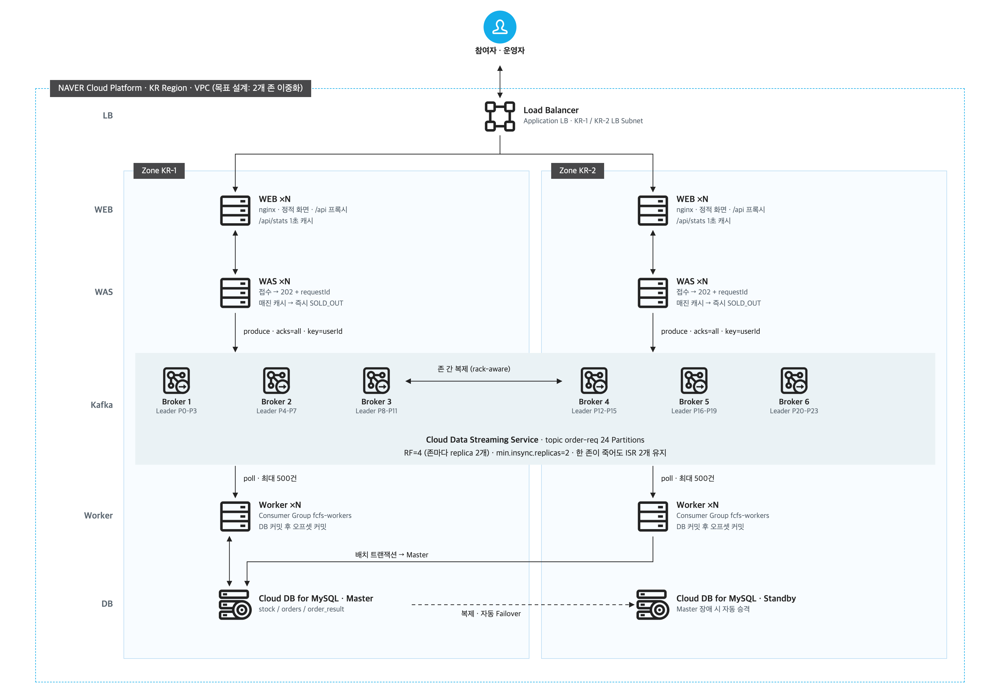
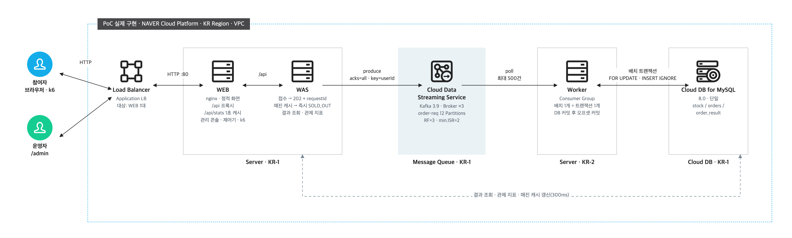
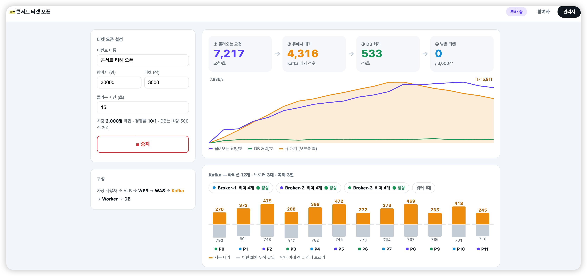

# 선착순 티케팅 트래픽 완충 시스템 설계

## 1. 도메인 배경 및 핵심 개념

티켓 오픈이나 선착순 이벤트는 짧은 시간에 요청이 몰립니다. 요청을 받자마자 DB에 쓰면 재고 행 잠금 경합으로 DB가 먼저 한계에 도달합니다.

이번 설계는 요청을 Kafka에 먼저 받고, Worker가 DB가 감당할 수 있는 속도로 꺼내 처리하는 구조입니다. 한정된 재고를 초과 판매나 중복 당첨 없이 판매하는 것이 목표입니다.

- 트래픽 완충: 유입 속도와 처리 속도의 차이를 큐가 흡수
- Consumer Lag: Kafka에 쌓였지만 아직 처리되지 않은 메시지 수
- Pull 모델: Worker가 자기 처리 속도에 맞춰 메시지를 가져감
- acks=all / ISR: 동기화된 복제본 모두에 기록되어야 쓰기 성공
- At-least-once: 처리 완료 후 오프셋 커밋. 유실 대신 중복 전달을 허용
- 멱등 처리: 같은 메시지가 여러 번 와도 결과는 한 번만 반영
- 매진 캐시: 재고가 0이면 큐를 거치지 않고 API에서 바로 매진 응답

## 2. 요구사항 및 설계 범위

### 기능적 요구사항

- `userId`로 이벤트 참여 요청
- 재고가 있으면 접수 후 `requestId` 즉시 반환(202)
- 재고가 없으면 큐를 거치지 않고 즉시 매진 응답
- `requestId`로 결과(대기, 당첨, 매진, 중복) 조회
- 한 사용자는 한 이벤트에 한 번만 당첨

### 비기능적 요구사항

- 유입이 DB 처리 속도를 넘어도 API는 즉시 응답
- 초과 판매 0, 중복 당첨 0
- 202로 접수한 요청은 유실 없이 처리
- 중복 전달이 생겨도 결과는 한 번만 반영
- 존 1개 장애 시에도 접수와 처리 지속
- 접수(WAS)와 처리(Worker)를 따로 수평 확장

### 추가 가정 및 제외 범위

- 참여자 10만 명이 20초 안에 몰리는 상황 가정
- 접수 단계 재고 판정(Redis Lua 게이트)은 제외. 매진 캐시와 DB 조건부 차감으로 대체
- 재시도·DLQ 토픽은 제외. 실패한 배치는 오프셋을 커밋하지 않고 재시도
- 결제, 좌석 지정, 대기열 UI는 제외

## 3. 아키텍처 설계도

### 설계도 (2개 존 이중화)

### 설계 설명

처리 경로: ALB → WEB → WAS → Kafka → Worker → MySQL

| 계층            | 배치                           | 존 1개 장애 시                  |
| ------------- | ---------------------------- | -------------------------- |
| Load Balancer | KR-1·KR-2 LB Subnet          | 장애 존의 WEB을 대상에서 제외         |
| WEB           | 존마다 N대                       | 남은 존이 전체 트래픽 처리            |
| WAS           | 존마다 N대                       | 남은 존이 계속 접수                |
| Kafka         | Broker 6대(존마다 3대)            | 남은 존의 replica 2개로 쓰기 계속    |
| Worker        | 존마다 N대, 같은 Consumer Group    | 남은 Worker가 Partition 재할당받음 |
| MySQL         | Master(KR-1) / Standby(KR-2) | Standby 자동 승격              |

**Kafka 구성**

- `order-req` 토픽 하나를 24개 Partition으로 나눴습니다. Broker가 6대라 한 대가 4개씩 맡습니다.
- 메시지 키는 `userId`입니다. 같은 사람의 요청은 항상 같은 Partition으로 들어갑니다.
- 메시지 하나를 4벌 복사해 두는데(RF=4), 존마다 2벌씩 들어가게 했습니다. 한 존이 통째로 죽어도 다른 존에 2벌이 남습니다.
- 쓰기는 살아 있는 복사본 2벌 이상에 저장돼야 성공으로 봅니다(`min.insync.replicas=2`, `acks=all`). 생산자가 재시도하면서 같은 메시지를 두 번 넣는 건 멱등 생산자 설정으로 막았습니다.

**계층별로 하는 일**

- WEB: 화면 파일을 내려주고 `/api` 요청을 WAS로 넘깁니다. 관제 지표는 캐시해 두고 줘서, 보는 사람이 많아도 DB에 부담이 안 갑니다.
- WAS: 매진인지 먼저 보고, 아니면 `requestId`를 만들어 Kafka에 넣은 다음 바로 202를 돌려줍니다. DB는 건드리지 않습니다.
- Worker: Kafka에서 최대 500건씩 가져와 한 트랜잭션으로 당첨·매진·중복을 판정합니다. DB에 커밋이 끝난 뒤에야 "여기까지 읽었다"(오프셋)를 Kafka에 알립니다.
- MySQL: 최종 판정을 하는 곳입니다. 재고 행 잠금과 UNIQUE 제약으로 초과 판매와 중복 당첨을 막습니다.

## 4. 기술 선택 근거

**Kafka**
- 요청은 Kafka에 넣는 것으로 접수를 끝냅니다. DB가 느려도 API는 바로 응답합니다.
- DB에 얼마나 빨리 쓸지는 Worker가 가져가는 속도로 정해집니다.

**Partition 24개 + Consumer Group**
- Worker를 늘리면 처리량이 같이 늘어납니다. 최대 24대까지 늘릴 수 있습니다.
- Worker 하나가 죽으면 남은 Worker가 그 Partition을 넘겨받습니다.

**MySQL 행 잠금 + UNIQUE 제약**
- 최종 판정은 DB 한 곳에서만 합니다. Worker가 몇 대든 결과가 같습니다.
- `FOR UPDATE`로 재고를 잠가 초과 판매를 막습니다.
- `UNIQUE(event_id, user_id)`는 중복 당첨을, `UNIQUE(request_id)`는 같은 메시지가 두 번 처리되는 것을 막습니다.

## 5. 트레이드오프

**1. 접수 후 바로 응답(202)**
- 장점: DB 상태와 상관없이 바로 응답합니다.
- 단점: 당첨 결과는 클라이언트가 따로 조회해야 합니다.

**2. 매진 캐시**
- 장점: 매진 뒤 요청은 큐에 넣지 않고 바로 끝냅니다.
- 단점: 캐시가 300ms마다 갱신되어 그사이 재고보다 조금 많은 요청이 큐에 들어갑니다. 최종 판정은 DB가 하므로 결과는 틀리지 않습니다.
- 대안: Redis에서 재고를 바로 차감하는 방법도 있지만, Redis와 DB 재고를 맞추는 부담이 생겨 뺐습니다.

**3. At-least-once**
- 장점: DB 커밋 후 오프셋을 커밋하므로 Worker가 죽어도 메시지가 사라지지 않습니다.
- 단점: 그 사이에 죽으면 같은 메시지가 다시 옵니다. `UNIQUE(request_id)`로 막습니다.

**4. 재고 행 하나를 잠금**
- 장점: 초과 판매가 구조적으로 불가능합니다.
- 단점: 이 행이 병목이라 Worker를 늘려도 한계가 있습니다. 배치로 묶어 줄이고, 더 크면 재고를 여러 행으로 나눕니다.

**5. Kafka 복사본 4벌(RF=4)**
- 장점: 존 하나가 죽어도 남은 존에 2벌이 있어 계속 쓸 수 있습니다.
- 단점: 저장 공간 4배, 존 간 복제 트래픽, 쓰기 응답 지연이 늘어납니다.
- RF=3이 안 되는 이유: 한 존에 2벌이 몰리고, 그 존이 죽으면 1벌만 남아 쓰기가 멈춥니다.
- 주의: 존이 2개뿐이면 Kafka 컨트롤러 과반을 유지할 수 없어서, 제3의 위치에 컨트롤러가 하나 더 필요합니다.

## 6. 구현 및 설계 검증

PoC 구성(계층마다 1대)을 NCP에 구축하고 k6로 최대 10만 명 부하 테스트를 했습니다.

설계 검증용으로 실제 구축한 구성입니다. 계층마다 1대, Kafka Broker 3대(KR-1), MySQL 단일입니다.

관리 콘솔 실행 화면 (참여자 3만 명, 티켓 3,000장, 15초 동안 유입)

- 위 그래프: 들어오는 요청(보라)이 DB 처리(초록)보다 훨씬 많고, 그 차이가 큐 대기(주황)로 쌓입니다.
- 위 카드: 요청은 초당 7천 건 넘게 들어오지만 DB는 초당 500건 정도만 처리합니다. 나머지는 Kafka에서 기다립니다.
- 아래 막대: 12개 Partition에 대기 메시지가 고르게 나뉘어 있고, Broker 3대가 Leader를 4개씩 맡고 있습니다.

확인한 것

- 유입이 DB 처리 속도를 넘어도 API는 즉시 응답하고, 차이는 Kafka lag로 쌓였다가 모두 처리됨

- 처리량 병목은 Kafka가 아니라 DB 쓰기 방식. 레코드 단위에서 배치 단위로 바꾼 뒤 처리량이 크게 늘어남
- 부하 중 서버 1대를 강제 종료해도 정합성 유지

테스트페이지

- [http://fcfs-alb-146938399-469a0f84965e.kr.lb.naverncp.com/admin](http://fcfs-alb-146938399-469a0f84965e.kr.lb.naverncp.com/admin)