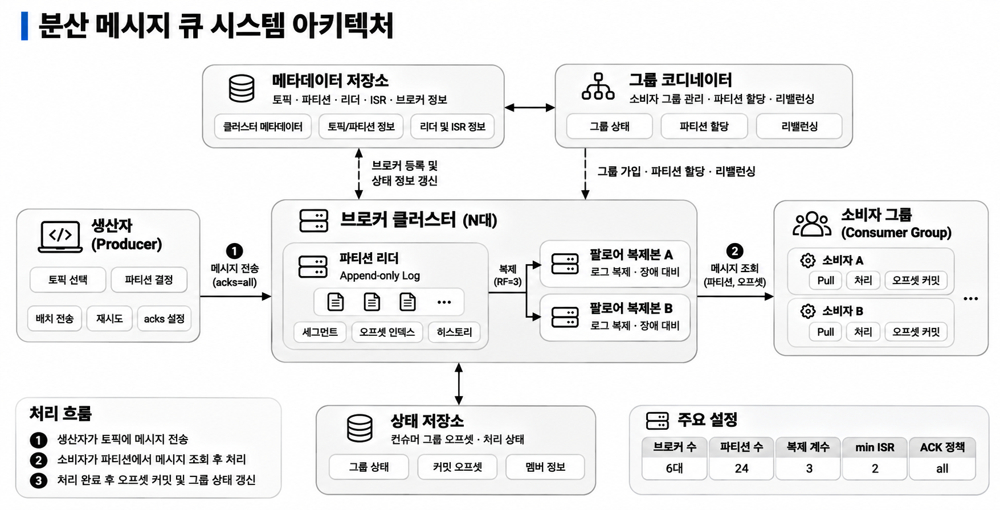

# 분산 메시지 큐 시스템 설계

## 1. 요구사항

| 항목 | 설계 기준 |
|---|---|
| 메시지 생산·소비 | 생산자가 토픽에 발행하고 소비자가 파티션에서 메시지를 조회 |
| 메시지 크기 | KB 수준의 메시지 지원 |
| 메시지 모델 | 소비자 그룹 내 작업 분배, 그룹 간 독립 소비 |
| 순서 보장 | **동일 파티션 내부**에서 오프셋 순서 보장. 토픽 전체 순서는 보장하지 않음 |
| 재처리 | 커밋 오프셋을 조정해 보관 중인 메시지 재조회 |
| 전달 보장 | At-most-once, At-least-once, Exactly-once 선택 가능 |
| 내구성 | 디스크 로그 저장, 다중 브로커 복제, 장애 시 리더 전환 |
| 확장성 | 토픽 파티션 분할, 브로커 증설, 소비자 그룹 확장 |
| 성능 정책 | 처리량 우선과 지연 우선 모드를 배치 설정으로 구분 |
| 데이터 보관 | 시간 또는 용량 기준으로 오래된 로그 세그먼트 정리 |
| 설계 범위 | 분산 메시지 큐의 논리 아키텍처, 저장·복제·소비·복구·확장 |

생산자와 소비자는 서로의 상태를 알 필요가 없다. 브로커가 메시지를 지속적으로 저장하므로 소비자가 일시적으로 중단돼도 보관 기간 내에 다시 읽을 수 있다. 하나의 토픽은 여러 파티션으로 분할하고 파티션별 리더를 통해 읽기와 쓰기를 처리한다.

## 2. 아키텍처

### 주요 구성요소

| 구성요소 | 역할 |
|---|---|
| Producer | 메시지 키로 파티션을 선택하고 리더 정보를 캐싱하며 파티션별로 배치 전송 |
| Broker | 파티션 로그 저장, 읽기·쓰기 요청 처리, 팔로어 복제 |
| Partition Leader | 파티션의 쓰기 순서를 결정하고 오프셋을 부여 |
| Follower | 리더 로그를 복제하고 장애 시 리더 후보가 됨 |
| Metadata Store | 토픽·파티션·브로커·리더 및 복제본 배치 정보 관리 |
| Consumer | 할당된 파티션에서 Pull 방식으로 조회하고 처리 후 오프셋 커밋 |
| Group Coordinator | 소비자 그룹 멤버십, 하트비트, 파티션 할당 및 재조정 관리 |
| State Store | 그룹 상태, 파티션 할당 결과, 커밋 오프셋 보관 |

메타데이터 저장소와 상태 저장소는 **역할을 논리적으로 분리**한다. 메타데이터는 브로커 클러스터의 토폴로지를 관리하고, 상태 저장소는 소비 진행 상태를 관리한다. 운영 시에는 각각 복제된 저장 계층을 사용해 단일 장애점을 제거한다.

## 3. 데이터 저장과 메시지 구조

### 메시지 형식

| 필드 | 용도 |
|---|---|
| `topic` | 메시지의 논리적 분류 |
| `partition` | 메시지가 기록될 파티션 |
| `offset` | 파티션 내 단조 증가 위치. 리더가 기록 시 부여 |
| `key` | 동일 키를 같은 파티션에 배치하기 위한 식별자 |
| `value` | 메시지 본문 |
| `timestamp` | 생성 또는 브로커 기록 시각 |
| `size`, `checksum` | 길이 검증 및 데이터 손상 감지 |

- 각 파티션은 **Append-only Log**로 저장한다. 새 메시지는 활성 세그먼트 끝에 순차 추가한다.
- 로그는 크기 기준으로 세그먼트를 회전하고, 오프셋 인덱스로 조회 대상 세그먼트와 파일 위치를 찾는다.
- 세그먼트에는 데이터 파일과 오프셋 인덱스를 두고 체크섬으로 손상을 감지한다.
- 보관 기한이 지난 닫힌 세그먼트를 정리한다. 메시지를 읽었다는 이유만으로 즉시 삭제하지 않는다.
- 파티션별 오프셋은 독립적이다. **서로 다른 파티션 사이에는 전역 순서가 없다.**

### 파티션 선택

- 키가 있으면 `hash(key) % partition_count` 방식으로 파티션을 결정한다.
- 키가 없으면 파티션 간 부하를 분산한다.
- 파티션 수가 변경되면 단순 모듈러 해시의 결과가 바뀔 수 있으므로 기존 키의 순서 연속성을 요구하는 토픽은 파티션 확장 전에 키 매핑 정책을 검토한다.
- 동일 파티션에 대한 생산자 재시도는 메시지 순서를 뒤집지 않도록 파티션별 전송 순서와 미확인 요청 수를 제한한다.

## 4. 생산자 설계

1. 생산자는 메타데이터 저장소에서 토픽의 파티션·리더 위치를 조회하고 로컬 캐시에 저장한다.
2. 메시지 키로 파티션을 선택한다.
3. 같은 파티션의 메시지를 배치로 모아 해당 리더 브로커에 전송한다.
4. 리더는 메시지를 로그에 기록하고 설정된 ACK 조건을 충족하면 응답한다.
5. 리더 변경 또는 일시적 네트워크 오류가 발생하면 메타데이터를 갱신한 뒤 재시도한다.

라우팅 요청마다 별도의 라우팅 서버를 통과시키지 않고 **생산자 내부에서 파티션과 리더를 선택**한다. 불필요한 네트워크 홉을 줄이는 대신 생산자가 리더 변경을 감지하고 메타데이터 캐시를 갱신해야 한다.

| 정책 | 설정 방향 | 효과 |
|---|---|---|
| 처리량 우선 | 배치 크기와 대기 시간을 늘리고 압축 사용 | 네트워크·디스크 효율 개선, 대기 지연 증가 |
| 지연 우선 | 작은 배치, 짧은 대기 시간 | 빠른 전송, 요청·시스템 호출 증가 |
| 재시도 | 재시도 가능한 오류만 재전송, 지수 백오프 | 일시적 장애 복구, 중복 가능성 |
| 중복 억제 | 생산자 ID와 파티션별 시퀀스 번호 검사 | 재시도 중 동일 기록 중복 방지 |

생산자 ID와 시퀀스 번호를 활용하는 경우 리더 변경 후에도 중복 판별 상태를 복원할 수 있어야 한다. 이 상태의 복구 가능 범위를 벗어나는 재전송까지 자동으로 제거한다고 가정하지 않는다.

## 5. 소비자 설계

### Pull과 오프셋

- 소비자는 할당된 파티션에 `Fetch(partition, offset, max_bytes)` 요청을 보낸다.
- 브로커는 해당 오프셋부터 읽을 수 있는 메시지를 반환한다.
- 소비자는 처리 결과를 확인한 뒤 **다음에 읽을 오프셋**을 커밋한다.
- 소비 위치는 메시지 저장 위치와 분리되므로 서로 다른 소비자 그룹은 같은 로그를 독립적으로 읽는다.
- 느린 소비자가 발생하면 메시지는 보관 기간 동안 로그에 남지만, 보관 기한이 지나면 재처리가 불가능하다.

### 소비자 그룹과 재조정

1. 소비자가 그룹 코디네이터에 참여 요청을 보낸다.
2. 코디네이터가 멤버십을 갱신하고 그룹 내 파티션을 할당한다.
3. 소비자는 하트비트를 보내고 자신에게 할당된 파티션만 소비한다.
4. 소비자 이탈·장애·파티션 변경이 감지되면 재조정을 시작한다.
5. 이전 할당을 회수하고 새 할당을 전달한다. 소비자는 저장된 커밋 오프셋부터 다시 읽는다.

하나의 소비자 그룹에서는 **한 파티션을 동시에 한 소비자에게만 할당**한다. 소비자 수가 파티션 수보다 많으면 일부 소비자는 유휴 상태가 된다. 재조정 중 중복 처리가 발생할 수 있으므로 소비자 처리 로직은 멱등하게 구성한다.

## 6. 메타데이터 및 상태 관리

| 저장 대상 | 저장 위치 | 갱신 계기 |
|---|---|---|
| 브로커 목록 및 생존 상태 | Metadata Store | 브로커 등록·장애·복귀 |
| 토픽과 파티션 구성 | Metadata Store | 토픽 생성·파티션 변경 |
| 파티션 리더 및 복제본 배치 | Metadata Store | 리더 선출·재배치 |
| 소비자 그룹 멤버십 | State Store | Join·Leave·세션 만료 |
| 파티션 할당 | State Store | 리밸런싱 |
| 커밋 오프셋 | State Store | 소비자의 커밋 요청 |

- 메타데이터의 변경은 버전 또는 세대를 함께 관리해 오래된 리더 정보로 요청하는 클라이언트를 식별한다.
- 코디네이터가 변경되면 새 코디네이터는 저장된 그룹 상태를 읽고 재조정한다.
- 파티션 할당에는 그룹 세대 번호를 부여해 이전 세대 소비자의 늦은 커밋을 거부한다.
- 저장소의 고가용성을 위해 다수 노드 합의 기반 복제를 적용하고, 과반을 확보하지 못한 경우 새로운 리더 선출이나 상태 변경을 제한한다.

## 7. 복제와 장애 복구

### 파티션 복제

- 파티션마다 리더 1개와 팔로어 복제본을 배치한다.
- **복제 계수 3**을 기본 정책으로 선택하고 서로 다른 브로커에 복제본을 배치한다.
- 팔로어는 리더의 로그를 지속적으로 따라가며, 동기화 상태를 만족하는 복제본을 ISR로 관리한다.
- 기본 내구성 정책은 `ACK=all`과 **최소 동기화 복제본 2개**로 정한다. ISR이 2개 미만이면 해당 파티션의 쓰기를 거부한다.
- 소비자에게 노출하는 읽기 가능 위치는 커밋된 로그 범위를 기준으로 한다. 아직 복제 조건을 만족하지 못한 기록은 정상 소비 결과로 노출하지 않는다.

| ACK 정책 | 응답 시점 | 특성 |
|---|---|---|
| ACK=0 | 응답을 기다리지 않음 | 지연·오버헤드 최소, 유실 감지 어려움 |
| ACK=1 | 리더 기록 후 | 낮은 지연, 리더 장애 시 미복제 데이터 유실 가능 |
| ACK=all | 설정된 복제 조건 충족 후 | 내구성 향상, 지연 및 가용성 비용 증가 |

### 브로커 장애 시 처리

1. 브로커 장애가 감지되면 메타데이터 관리 계층이 해당 브로커를 비정상으로 표시한다.
2. 장애 파티션의 ISR 중 하나를 새 리더로 선출한다.
3. 새 리더 정보와 리더 세대를 메타데이터에 반영한다.
4. 생산자는 오래된 리더 요청이 거부되면 메타데이터를 갱신해 재전송한다.
5. 복귀한 브로커는 현재 리더의 로그와 동기화한 뒤 다시 복제본으로 참여한다.

이전 리더가 네트워크 분리 후 복귀하더라도 오래된 리더 세대로 쓰기를 수락하지 않도록 **리더 세대 기반 펜싱**을 적용한다. ISR 후보가 없을 때 비동기 복제본을 강제로 리더로 올리면 데이터가 유실될 수 있으므로, 기본 정책은 **쓰기 중단을 감수하고 데이터 보존을 우선**한다.

## 8. 메시지 전달 보장

| 방식 | 소비 처리·커밋 순서 | 장단점 |
|---|---|---|
| At-most-once | 오프셋 커밋 → 메시지 처리 | 중복 감소, 처리 전 장애 시 유실 가능 |
| At-least-once | 메시지 처리 → 오프셋 커밋 | 유실 가능성 감소, 커밋 전 장애 시 중복 가능 |
| Exactly-once | 중복 식별 + 처리 결과와 소비 위치의 원자적 확정 | 중복·유실 억제, 상태·트랜잭션 관리 비용 증가 |

기본 소비 정책은 **At-least-once**로 설정한다. 처리 성공 후 오프셋을 커밋하며, 장애 재처리 시 동일 메시지가 다시 전달될 수 있으므로 소비자 측 멱등 처리를 요구한다.

Exactly-once는 단순히 ACK=all을 설정한다고 달성되지 않는다. 메시지 기록 단계의 중복 제거, 소비 결과와 오프셋의 원자적 커밋, 외부 시스템에 대한 멱등 키 또는 트랜잭션 경계가 함께 필요하다. 외부 DB나 API가 트랜잭션에 참여하지 않으면 **큐 내부의 정확히 한 번 처리와 외부 부작용의 정확히 한 번 실행은 별개**다.

## 9. 규모 확장

| 확장 대상 | 방법 | 주의점 |
|---|---|---|
| Producer | 생산자 인스턴스 추가 | 파티션별 핫키와 전송 순서 |
| Consumer | 그룹 내 소비자 추가 | 파티션 수를 넘는 소비자는 유휴 상태 |
| Broker | 브로커 추가 후 리더·복제본 재배치 | 복제 트래픽과 디스크·네트워크 부하 |
| Partition | 토픽 파티션 수 증가 | 키 매핑 변경, 기존 메시지와의 순서 관계 |
| Metadata/State | 복제 및 책임 분산 | 상태 일관성과 리더 선출 |

브로커를 추가하는 것만으로 기존 데이터가 자동으로 균등하게 배치되지는 않는다. 파티션별 저장 용량·입출력·복제 지연을 확인하고 복제본을 점진적으로 재배치한다. 파티션 증설은 처리 병렬성을 높이지만 기존 키의 파티션이 변경될 수 있으므로 순서 보장이 필요한 토픽에서는 별도 전환 정책을 둔다.

## 10. 장애 대응 및 관측

| 상황 | 대응 | 한계 |
|---|---|---|
| 생산자와 리더 간 통신 오류 | 메타데이터 갱신, 백오프 재시도, 시퀀스 중복 검사 | ACK 유실 시 결과 불확실성 |
| 리더 브로커 장애 | ISR에서 새 리더 선출, 세대 변경, 클라이언트 재접속 | 선출 중 일시 중단 |
| ISR 부족 | ACK=all 쓰기 거부, 복제 복구 대기 | 쓰기 가용성 감소 |
| 소비자 장애 | 하트비트 만료 후 재조정, 마지막 커밋 오프셋부터 재개 | 중복 처리 가능 |
| 코디네이터 장애 | 새 코디네이터가 저장 상태를 복원 | 재조정 지연 |
| 저장 디스크 부족 | 보관 정책 확인, 브로커 확장·파티션 재배치 | 보관 기한 이전 데이터는 임의 삭제하지 않음 |
| 소비 지연 | Consumer Lag 확인, 소비자 또는 파티션 확장 | 보관 기간 초과 시 재처리 불가 |

주요 관측 지표는 Produce/Fetch 요청 지연(p50·p95·p99), 초당 메시지 수, 배치 크기, 파티션별 적재량, Consumer Lag, ISR 크기, 복제 지연, 리더 변경 횟수, 리밸런싱 시간, 커밋 실패율, 디스크 사용률이다.

## 11. 기술 선택과 트레이드오프

| 설계 결정 | 선택 이유 | 비용·한계 |
|---|---|---|
| 파티션 기반 분산 | 병렬 처리와 수평 확장 | 토픽 전체 순서 보장 불가 |
| 생산자 내부 라우팅 | 별도 라우팅 홉 제거 | 클라이언트 메타데이터 관리 필요 |
| Append-only Log | 순차 쓰기와 재처리 지원 | 보관 용량과 세그먼트 관리 필요 |
| Pull 소비 | 소비자별 처리 속도 제어 | 폴링·배치 설정 필요 |
| 복제 계수 3, ACK=all | 단일 브로커 장애에 대한 내구성 강화 | 저장 공간·네트워크·지연 비용 |
| ISR 부족 시 쓰기 거부 | 확인된 메시지의 유실 위험 감소 | 장애 상황의 쓰기 가용성 저하 |
| At-least-once 기본값 | 처리 실패 후 재시도 가능 | 소비자 멱등 처리 필요 |
| 그룹 코디네이터 | 파티션 소유권과 재조정 일원화 | 코디네이터 상태 복구 필요 |

## 12. 설계 검증 항목

- 생산자 ACK 응답 유실 후 재시도에서 중복 기록이 억제되는지 확인한다.
- 리더 장애 및 네트워크 분리에서 오래된 리더가 쓰기를 수락하지 않는지 확인한다.
- ISR이 최소 조건 아래로 감소하면 쓰기가 차단되고 복구 후 재개되는지 확인한다.
- 소비자 장애·리밸런싱 중 파티션 소유권과 커밋 오프셋이 올바르게 이전되는지 확인한다.
- 브로커·파티션 증설 시 데이터 이동량, 지연, 핫파티션, 키 순서 영향도를 확인한다.
- 처리량 우선/지연 우선 설정에서 Produce·Fetch 지연과 배치 효율을 비교한다.

이 설계는 파티션 단위의 순서 보장과 로그 기반 재처리를 제공하고, 복제 및 상태 관리로 장애 복구를 지원한다. 기본값은 **내구성 우선 쓰기(ACK=all)와 At-least-once 소비**로 두며, 메시지의 중요도와 처리 지연 요구에 따라 정책을 조정한다.
