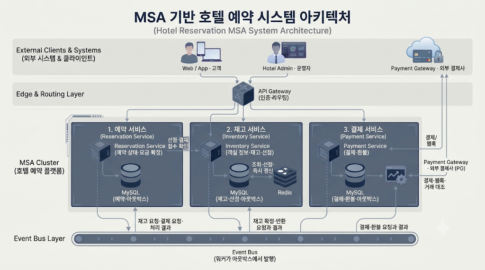
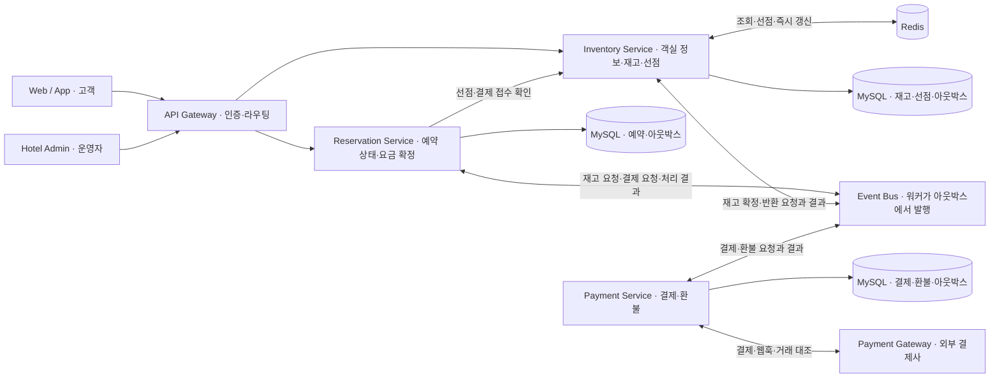
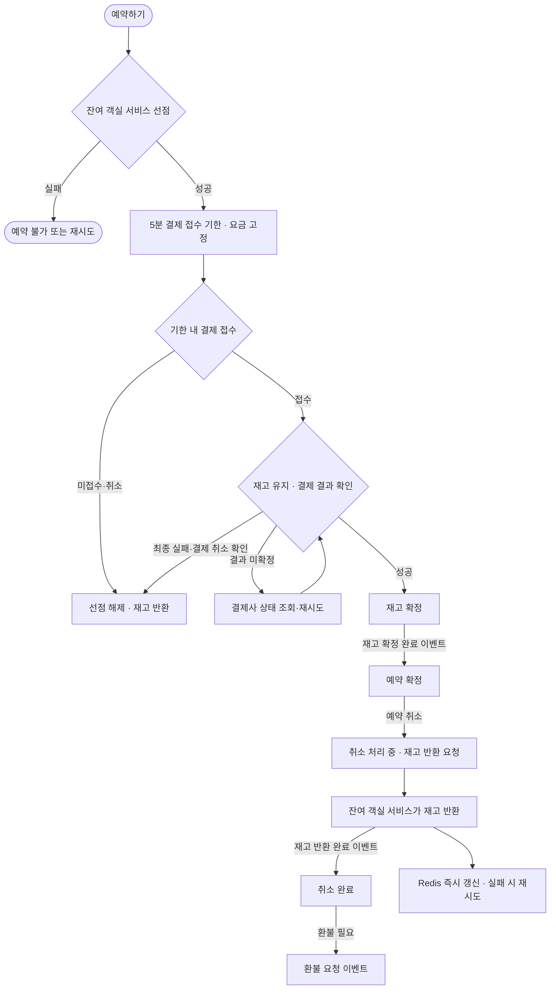
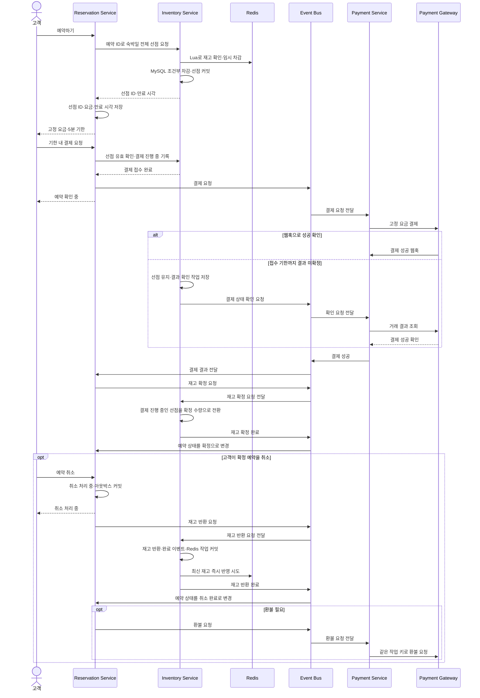

# 호텔 예약 시스템 설계

## 1. 도메인 배경 및 핵심 개념

호텔 예약은 **객실 유형의 숙박일별 수량**을 판매한다. 20일 체크인, 22일 체크아웃이면 호텔 현지 날짜로 20일과 21일에 같은 유형의 객실이 각각 필요하다. 실제 객실 번호는 현장에서 배정한다.

- **재고 단위** — `(hotel_id, room_type_id, stay_date)`
- **선점** — 결제를 기다리는 동안 투숙일 전체의 재고를 임시 확보한다.
- **초과 예약** — 일자별 판매 상한은 `⌊실제 가용 객실 × 1.10⌋`이다. 확정 수량이 실제 객실을 넘으면 부족 수량을 표시하고 운영자에게 인계한다.

## 2. 요구사항 및 설계 범위

### 기능적 요구사항

- **시스템 규모** — 호텔 5,000개, 객실 100만 개
- **결제** — 예약할 때 전액 결제
- **예약 정책**
  - 호텔 웹·앱에서만 예약할 수 있으며, 고객은 본인 예약을 조회·취소한다.
  - 실제 가용 객실 수의 10%까지 초과 예약을 허용한다.
  - 요금은 숙박일과 잔여 재고에 따라 달라지며, 선점된 예약에는 당시 요금을 적용한다.
- **주요 기능**
  - 호텔·객실과 날짜별 요금·재고 조회
  - 객실 선점, 결제, 예약 확정·취소
  - 관리자 호텔·객실 CRUD, 판매 재고 조정 및 객실 부족 확인

### 비기능 요구사항

- 동시 요청이 몰려도 신규 선점은 모든 숙박일의 판매 상한을 지킨다.
- 동일 요청이나 이벤트가 다시 와도 재고 차감·반환과 청구·환불은 한 번만 반영한다.
- 예약 처리에 몇 초까지 허용한다. 서비스 간 처리가 진행 중이면 고객에게 현재 상태를 표시한다.

### 추가 가정 및 제외 범위

- 교재의 평균 가정은 점유율 70%, 평균 3박이다. 상세 조회 약 300 QPS, 예약 전 상세 조회 약 30 QPS, 예약 생성 약 3 TPS다. 피크 선점 요청에는 결제 전 이탈도 포함된다.
- 한 예약에서 한 호텔의 같은 유형 객실을 여러 개 잡을 수 있다.
- 호텔 간 검색, 외부 예약 채널 연동, 객실 배정 자동화, 환불 금액 산정은 범위에서 제외한다.

## 3. 아키텍처 설계도

### 시스템 구성

채택한 서비스 경계와 이벤트 흐름

### 예약·결제 플로우차트

### 예약·결제·취소 시퀀스

## 4. 기술 선택 근거

### 서비스별 MySQL과 이벤트

- **예약 서비스**는 예약 상태와 확정 요금을 저장한다. **잔여 객실 서비스**는 판매 재고·선점과 Redis를 관리한다. **결제 서비스**는 결제·환불 작업과 외부 결제사 연동을 맡는다.
- 각 서비스는 상태 변경과 발행할 이벤트를 자기 MySQL에 함께 커밋한다. 워커가 아웃박스를 조회해 Event Bus에 발행한다. 소비자는 처리 기록과 상태 변경을 같은 트랜잭션에 남겨 이벤트가 다시 와도 같은 효과를 반복하지 않는다.
- **취소**는 예약 서비스가 `취소 처리 중`을 기록하고 재고 반환을 요청한다. 결제 결과를 아직 확인 중이라면 결과를 먼저 대조한다. 잔여 객실 서비스가 반환을 커밋하고 `재고 반환 완료`를 발행하면, 예약 서비스가 `취소 완료`로 바꾸고 필요한 환불을 별도로 요청한다.

### Redis 선점과 MySQL 동시성 제어

- `available:{h123:deluxe}:2026-11-20`에 숙박일별 수량을 둔다. 금·토에 2개·1개가 남으면 Lua가 두 날짜를 확인하고 함께 1개·0개로 차감한다. 다음 2박 요청은 토요일이 부족해 두 날짜 모두 차감하지 않는다.
- 같은 스크립트에서 선점 ID와 숙박일·수량을 기록한다. Redis Cluster에서는 같은 호텔·객실 유형의 키를 해시 태그로 같은 슬롯에 둔다. [Redis Lua와 Cluster](https://redis.io/docs/latest/develop/programmability/eval-intro/) · [해시 태그](https://redis.io/docs/latest/operate/oss_and_stack/reference/cluster-spec/#hash-tags)
- 예약 서비스는 예약 ID를 먼저 저장하고 잔여 객실 서비스에 선점을 요청한다. 응답이 끊기면 같은 ID로 기존 결과를 확인한다. 선점만 남은 경우 만료 워커가 재고를 반환한다.

| 방식 | 비교 |
| --- | --- |
| **비관적 락** | `SELECT … FOR UPDATE`로 먼저 잠근 뒤 확인한다. 경합 시 잠금 대기가 길어진다. |
| **낙관적 락** | 버전이 같을 때만 갱신한다. 수량이 충분해도 버전 충돌이면 재시도한다. |
| **조건부 갱신(선택)** | `확정 + 선점 + 요청 수량 ≤ 판매 상한`일 때만 차감한다. Redis로 경합을 줄이고 MySQL의 현재 수량으로 판정한다. 쓰기 대기는 남는다. |

잔여 객실 서비스는 숙박일 순서로 갱신한다. 어느 하루라도 실패하면 재고 DB의 전체 트랜잭션을 롤백하고 Redis 임시 차감을 복구한다. 보수로 실제 재고가 줄면 즉시 반영하고, 기존 확정 예약과 유효한 선점은 유지하며 새 상한을 넘는 요청은 거절한다.

### 결제와 선점 기한

- **결제 접수** — 재고 DB의 선점 커밋부터 5분 동안 새 결제를 받는다. 잔여 객실 서비스가 선점 행의 기한과 상태를 확인해 `결제 진행 중`으로 바꾼 뒤 예약 서비스가 결제 요청을 발행한다. 만료 워커도 같은 행을 확인해 미접수 선점만 해제한다.
- **기한 내 접수한 결제** — 결제 서비스가 결제사를 호출한다. 잔여 객실 서비스는 결제 결과가 확정될 때까지 재고를 유지한다. 접수 기한이 지났는데 결과를 모르면 결제 서비스에 대조를 요청한다. 결제 서비스는 작업 키에 연결된 거래를 조회하고, 미확정이거나 조회에 실패하면 다시 확인한다.
- **결과 반영** — 성공이 확인되면 잔여 객실 서비스가 선점을 확정 수량으로 바꾸고, 완료 이벤트를 받은 예약 서비스가 예약을 확정한다. 그전에는 `예약 확인 중`으로 표시한다. 결제 최종 실패나 결제 취소가 확인되면 재고를 반환한다. 고객이 취소를 요청한 결제가 이미 성공했다면 취소·재고 반환과 별도로 환불한다.

### Redis 재고 동기화와 조회 캐시

- 재고 반환과 함께 Redis 갱신 작업을 재고 DB 아웃박스에 저장한다. 잔여 객실 서비스가 커밋 직후 Redis 갱신을 시도하고, 실패하면 워커가 미완료 작업을 재시도한다. **취소 완료는 재고 DB 반환을 기준으로 한다.**
- Redis에는 더 최신인 재고 버전만 반영한다. DB 수량에 포함된 선점의 임시 차감을 정리해 중복 계산을 막는다. 캐시 누락·갱신 지연·Redis 장애 시 호텔별·전체 요청량을 제한해 재고 DB를 확인한다.
- 호텔·객실 정보는 캐시 미스 때 DB에서 채우고 관리자 변경 시 무효화한다. 조회 화면의 예상 요금에는 짧은 TTL을 적용한다.

### 재고 DB 샤딩

- 재고 서비스는 단일 MySQL로 시작한다. 여러 호텔의 쓰기 부하가 커지면 `hotel_id`로 선점·일자별 재고·아웃박스를 한 샤드에 묶는다.
- `h123 → shard-02`처럼 호텔별로 매핑한다. 책의 `hash(hotel_id) % 샤드 수`는 계산이 단순하고, 매핑은 증설 때 옮길 호텔을 고를 수 있다. 인기 호텔 한 곳에 몰리는 경합은 해당 샤드에 남는다.

## 5. 트레이드오프

- **예약·재고 DB 분리** — 독립 배포와 확장이 가능하다. 동일 DB에서는 취소와 재고 반환을 한 번에 커밋할 수 있고, 분리 구조에서는 이벤트 반영을 기다리는 동안 `취소 처리 중`이 필요하다. 교재 7장은 동일 DB를 최종안으로 선택했다.
- **Redis 선점** — 인기 날짜의 경쟁을 먼저 줄인다. Redis와 MySQL의 수량을 맞출 작업과 장애 시 제한된 DB 경로가 필요하다.
- **취소 직후 Redis 갱신** — 반환된 객실이 빨리 보인다. Redis 장애 시 워커가 재시도하는 동안 잠시 이전 수량이 보일 수 있다.
- **결제 결과 확인 후 해제** — 기한 안에 접수한 결제는 내부 이벤트가 늦어도 객실을 보장한다. 결제사 장애 중에는 결과를 모르는 결제의 재고가 더 오래 묶일 수 있다.

## 6. 구현 및 설계 검증

| 상황 | 기대 결과 |
| --- | --- |
| 마지막 토요일 객실에 2박 동시 요청 | 한 요청만 선점하고, 실패 요청의 금요일 차감도 롤백된다. |
| 재고 반환 요청이 두 번 전달되거나 완료 이벤트 발행 전 서버 종료 | 재고 반환은 한 번만 반영된다. 아웃박스의 완료 이벤트로 예약을 취소 완료로 전환한다. |
| 재고 반환 커밋 직후 Redis 장애 | 재고 DB 반환은 유지되고, 미완료 갱신을 워커가 재시도한다. |
| 기한 내 접수한 결제가 성공했지만 내부 이벤트가 기한 뒤 도착 | 선점을 유지하고, 성공이 확인되면 예약을 확정한다. |
| 접수 기한에 결제 결과를 조회했지만 미확정 | 재고를 유지하며 다시 조회한다. 최종 실패 또는 결제 취소가 확인되면 반환한다. |
| 객실 100개 중 105개 확정 후 10개 판매 중지 | 신규 선점을 막고 부족 수량 15개를 표시한다. |
