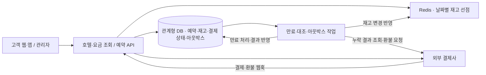

# 호텔 예약 시스템 설계

교재 『가상 면접 사례로 배우는 대규모 시스템 설계 기초 2』 7장(책 231–264쪽, PDF 239–272쪽)을 바탕으로, Redis 선점부터 선결제·예약 확정·취소까지의 흐름을 설계했다.

## 1. 도메인 배경 및 핵심 개념

고객은 호텔과 객실 유형을 선택하고, 실제 객실 번호는 현장에서 배정받는다. 재고의 기준은 `(hotel_id, room_type_id, stay_date)`다. 호텔 현지 날짜 기준으로 20일 체크인, 22일 체크아웃이면 20일과 21일의 객실을 각각 확보해야 한다. 어느 하루라도 부족하면 2박 전체가 성립하지 않는다.

`가용 객실`은 해당 날짜에 실제 운영할 수 있는 객실이다. `판매 상한 = floor(가용 객실 × 1.10)`이고, 확정 예약과 재고를 점유 중인 선점을 합산해 신규 판매 여부를 판단한다. 실제 객실 100개라면 110개까지 팔 수 있다. 105팀이 도착하면 5팀의 대체 숙박이 필요하므로, 운영 화면에 날짜·객실 유형별 부족 수량을 표시해 담당자에게 인계한다.

## 2. 요구사항 및 설계 범위

### 기능적 요구사항

- 호텔 체인의 웹·앱에서 호텔과 객실 상세 정보, 선택한 호텔의 숙박일별 요금 및 예약 가능 여부를 조회한다.
- 객실 유형과 숙박 기간을 선택해 재고를 선점하고 전액 결제한다. 고객은 본인의 예약 목록·상세·결제 상태를 확인하고 취소할 수 있다.
- 날짜별 잔여 재고를 반영해 요금이 달라질 수 있다. 고객이 선점할 때 숙박일별 단가·총액·통화를 함께 고정한다.
- 관리자는 호텔·객실 정보를 등록·수정·삭제하고, 보수 등으로 바뀐 날짜별 가용 객실을 반영한다. 기존 예약을 참조할 수 있도록 삭제된 호텔·객실 정보는 판매와 공개 조회에서 내린다.
- 가용 객실보다 10%까지 더 판매한다. 확정 수량이 실제 가용 객실을 넘으면 운영 화면에 부족 수량을 표시한다.

### 비기능적 요구사항

- 특정 호텔·객실 유형·숙박일에 요청이 몰려도 신규 선점은 판매 상한을 지킨다. 실패한 요청은 일부 날짜의 재고만 차감한 상태를 남기지 않는다.
- 같은 요청을 재전송하거나 결제 결과가 중복 전달돼도 선점·청구·확정·환불이 중복 처리되지 않도록 한다.
- 일반 예약 요청은 몇 초 안에 응답하는 것을 목표로 한다. 결제 결과가 늦으면 `결제 확인 중`을 반환하고 이후 상태를 조회할 수 있게 한다.
- 교재의 규모 가정은 호텔 5,000개, 객실 100만 개, 평균 점유율 70%, 평균 3박이다. 호텔·객실 상세 조회 약 300 QPS, 예약 전 상세 조회 약 30 QPS, 예약 생성 약 3 TPS는 평균 추정치다. 신규 선점 시도에는 결제 전에 이탈한 고객도 들어가므로 피크 부하는 따로 봐야 한다.

### 추가 가정 및 제외 범위

- 한 요청은 한 호텔의 한 객실 유형을 대상으로 하고, 같은 유형의 객실은 여러 개 함께 예약할 수 있다고 가정한다.
- 고객에게 안내한 선점은 5분 동안 유효하다. 5분 안에 서버가 결제를 접수한 경우에만 최초 선점 시각부터 최대 7분까지 유지한다.
- 호텔 간 검색, 전화·외부 예약 플랫폼 연동, 실제 객실·대체 숙박 배정 자동화와 환불 금액 산정 정책은 범위에서 제외한다. 환불이 필요한 경우 요청·조회·재시도 흐름을 다룬다.

## 3. 아키텍처 설계도

예약 서비스가 예약·선점·일자별 재고를 소유한다. 관계형 DB가 고객에게 안내한 선점과 확정 예약의 기준이다. Redis는 DB 쓰기 전에 신규 선점 요청을 거른다. 백그라운드 작업은 기한이 지난 선점 정리, 결제 대조, Redis 반영과 환불 요청을 맡는다.

### 데이터와 API

| 데이터 | 역할 |
| --- | --- |
| `hotel`, `room_type`, `room`, `daily_rate` | 호텔 및 객실 정보, 호텔·유형·일자별 요금 |
| `daily_inventory` | 호텔·유형·숙박일별 실제 가용 객실, 선점 수량, 확정 수량, 재고 버전 |
| `reservation` | 고객·객실 유형·숙박 기간·수량, 상태와 만료 시각, 고정 요금, 요청 키 |
| `payment_attempt`, `refund` | 결제사에 전달하는 작업 키, 거래 ID, 금액·통화 및 처리 상태 |
| `outbox` | 재고 변경이나 환불과 함께 커밋한 후속 작업 |

고객 API는 호텔·객실 상세 조회, 날짜별 재고·요금 조회, `POST /reservations/holds`, `POST /reservations/{id}/payment`, 예약 목록·상세 조회, `POST /reservations/{id}/cancel`을 제공한다. 관리자 API는 호텔·객실 등록·수정·삭제와 날짜별 판매 재고 관리를 제공한다. 고객 예약은 소유자가 조회·변경하고, 관리 작업은 해당 호텔에 권한이 있는 운영자가 수행한다.

### 선점부터 예약 확정까지

1. **Redis에서 먼저 확보한다.** 고객이 `예약하기`를 누르면 Redis 스크립트가 투숙일 전부에 수량이 남았는지 확인하고 한 번에 임시 차감한다. Redis Cluster를 쓸 경우 같은 호텔·객실 유형의 날짜별 키는 같은 슬롯에 둔다. Redis에서 마지막 객실을 잡은 요청만 DB에 재고 쓰기를 시도한다. [Redis Cluster의 다중 키 연산](https://redis.io/docs/latest/management/scaling/)
2. **DB에 같은 선점을 기록한다.** 날짜 순으로 `held_count + confirmed_count + 요청 수량 <= 판매 상한`일 때만 `held_count`를 조건부로 증가시킨다. 필요한 숙박일 중 하나라도 갱신되지 않으면 전체를 롤백한다. 선점과 고정 요금이 함께 커밋되면 5분 타이머를 응답한다. 롤백이 확인되면 Redis에서 임시 차감한 수량을 돌려준다.
3. **결제를 접수한다.** 기한 내의 선점만 결제 확인 중 상태로 변경한다. 서버는 결제 작업 키를 먼저 저장하고, DB 트랜잭션 밖에서 저장된 총액을 결제사에 전달한다. 응답이 끊기면 웹훅이나 조회로 결과를 확인하고, 유효 기한 내에 재호출이 필요하면 같은 작업 키를 사용한다.
4. **성공이면 확정한다.** 웹훅 또는 결제사 조회 결과에서 거래 ID·금액·통화를 확인한다. 선점이 유효하면 한 트랜잭션에서 `held_count`를 줄인 만큼 `confirmed_count`를 늘리고 예약을 확정한다. 여러 번 온 결제 결과는 예약·결제 시도의 상태를 조건으로 한 번만 반영한다.

선점 요청 키는 고객별로 유일하게 저장한다. 저장에 성공한 뒤 응답이 끊기면, 같은 키로 재시도한 고객에게 기존 선점과 만료 시각을 돌려준다. 같은 키에 다른 숙박 조건이 들어오면 충돌로 처리한다. 결제사는 작업 키 기반 중복 방지와 거래 조회를 지원한다고 가정한다.

### 선점 해제와 취소

| 상황 | 처리 |
| --- | --- |
| 결제 전 고객이 이탈하거나 선점을 취소 | 이탈은 5분 만료 시, 명시적 취소는 즉시 재고를 반환한다. |
| 결제 실패가 확인됨 | 유예 종료를 기다리지 않고 선점을 해제한다. |
| 5분 안에 결제를 접수했고 결과가 미확정 | 최초 선점부터 최대 7분까지 유지한다. 결과가 오면 즉시 처리하고, 7분이 지나면 선점을 해제한다. 재시도로 기한을 늘리지 않는다. |
| 기한이 지난 뒤 결제 성공 확인 | 선점이 남아 있으면 해제한다. 예약을 만료 상태로 두고 해당 거래의 환불 작업을 한 번 생성한다. |
| 고객이 확정 예약을 취소 | 취소 상태 변경과 재고 반환을 한 트랜잭션으로 처리한다. 필요 시 환불 작업을 함께 저장하고, 고객에게 취소와 환불 상태를 각각 보여준다. |

만료 작업은 DB의 만료 시각을 기준으로 확인한다. 만료와 결제 확정이 동시에 실행되면 같은 예약 상태를 잠근 뒤 서버가 정한 기한과 현재 상태를 검사한다. 먼저 커밋된 전이가 재고를 변경하며, 기한이 지난 결제는 확정 조건을 통과할 수 없다. 만료 정리가 늦어지면 그 기간의 조회는 보수적으로 남은 재고를 계산한다.

### 재고 변경과 Redis 복구

- **보수로 재고가 감소하면** 실제 가용 객실을 즉시 반영한다. 확정 예약과 유효한 선점은 유지한다. 변경된 판매 상한을 이미 넘겼다면 신규 선점만 막고, 실제 객실 대비 확정 수량이 초과하면 운영 화면에 부족 수량을 표시한다.
- **취소·만료·관리자 변경과 Redis 반영이 어긋나면** 같은 DB 트랜잭션에 넣은 아웃박스가 변경을 다시 전달한다. 작업은 DB 재고의 최신 버전과 수량을 Redis에 반영하면서, 같은 스냅숏에 포함된 선점 ID의 임시 차감을 해제한다. 중복 또는 오래된 이벤트는 재고를 다시 늘리지 않는다. [트랜잭셔널 아웃박스](https://docs.aws.amazon.com/prescriptive-guidance/latest/cloud-design-patterns/transactional-outbox.html)
- **Redis에서 임시 차감한 직후 요청이 끊기면** 일정 시간이 지난 임시 기록을 정리 작업이 확인한다. DB에서 같은 요청 키의 커밋 여부를 대조하고, 확인한 재고로 다시 계산한다. 이 기록은 DB 쓰기를 기다리는 짧은 구간에 쓰이며, 고객에게 안내한 5분 선점은 DB 만료 시각으로 관리한다.
- **Redis가 유실되거나 접속할 수 없으면** 기존 예약의 결제·조회·취소는 DB에서 처리한다. 새 선점은 호텔별·전체 요청 제한을 적용해 DB 경로로 받는다. Redis 복구 시 DB 재고로 다시 채운다. 복구 중 생긴 변경도 DB 재고 버전으로 확인하며, 준비가 끝난 재고부터 Redis 선점 경로로 돌린다.

## 4. 기술 선택 근거

| 선택 | 해결하려는 문제 |
| --- | --- |
| Redis 선점 이후 같은 선점을 DB에 저장 | 인기 날짜의 경쟁을 Redis에서 먼저 줄이고, 고객에게 안내한 5분 선점은 Redis 재시작 뒤에도 복구한다. |
| 관계형 DB와 조건부 갱신 | 재고 확인과 차감을 같은 쓰기로 처리한다. 여러 숙박일의 재고와 선점 상태, 예약 기록을 한 트랜잭션에 묶는다. 관리자가 실제 재고를 줄일 수 있으므로 판매 상한 조건은 신규 선점 갱신에 적용한다. |
| 결제사 웹훅과 누락 결과 조회 | 정상 결과는 빠르게 반영한다. 응답·웹훅이 누락되면 같은 거래를 조회해서 확정 또는 환불까지 이어간다. |
| 트랜잭셔널 아웃박스 | DB 변경 직후 서버가 종료돼도 Redis 갱신과 환불 작업이 남는다. 백그라운드 작업은 실패한 작업을 재시도한다. |

초기에는 재고의 복합 기본키와 예약의 고객별 조회용 인덱스를 둔 관계형 DB 한 곳으로 시작한다. 조회·쓰기 부하가 커지면 과거 예약을 아카이브하고, 이후 `hotel_id` 기준 샤딩을 검토한다. 같은 호텔의 여러 숙박일을 같은 샤드에 두면 예약 트랜잭션을 유지할 수 있다. 인기 호텔 하나에 집중되는 경합은 호텔별 요청 제한과 Redis의 선점 단계에서 다룬다.

## 5. 트레이드오프

| 채택한 방향 | 검토한 대안과 감수할 점 |
| --- | --- |
| Redis 선점 성공 후 DB 저장 | 결제 시작 때까지 Redis에만 보관하면 DB 쓰기를 줄일 수 있다. 즉시 저장하면 이탈한 고객의 선점도 기록하고 만료 작업을 실행해야 하지만, 이미 보여준 타이머를 장애 뒤에도 존중할 수 있다. |
| DB 조건부 갱신 | 비관적 락은 날짜별 상태를 읽고 갱신하는 순서가 명시적이고, 낙관적 락은 경합이 낮을 때 적합하다. 조건부 갱신은 현재 수량이 충분한 요청을 살리지만 같은 재고 행의 쓰기 대기는 남는다. |
| 예약·재고를 동일 서비스와 DB에 배치 | 독립 DB로 분리하면 확장이 유연해지지만 여러 날짜 중 일부만 성공한 경우를 보상해야 한다. 동일 DB는 트랜잭션을 단순하게 유지하는 대신 쓰기 부하를 함께 감당한다. |
| 5분 고정 선점과 결제 중 최대 2분 유예 | 모든 선점을 5분에 해제하면 재고 회전은 빠르다. 결제 중에만 유예하면 응답 지연을 흡수하는 대신 다음 고객이 더 기다린다. |
| 아웃박스 기반 재고 반영 | 취소 요청에서 Redis까지 바로 갱신하면 빈 객실이 빠르게 보인다. 아웃박스는 누락을 복구할 수 있지만 반영 전에는 취소된 객실이 잠시 매진으로 보일 수 있다. |
| 제한된 DB 대체 경로 | Redis 복구까지 새 선점을 멈추면 DB 보호가 쉽다. 일부 선점을 계속 받는 방식은 호텔별·전체 한도를 운영해야 한다. |

## 6. 구현 및 설계 검증

| 시나리오 | 기대 결과 |
| --- | --- |
| 마지막 토요일 객실에 금·토 2박 요청이 동시에 들어옴 | 한 요청만 선점한다. 실패한 요청의 금요일 재고 차감도 남지 않는다. |
| 선점 커밋 후 응답 유실, 같은 키로 재시도 | 기존 선점과 만료 시각을 반환한다. |
| 4분 59초에 결제 접수, 7분 이후 성공 확인 | 기한에 재고를 회수하고, 나중에 확인한 결제는 환불한다. |
| 100개 중 105개 확정 후 보수로 10개 판매 중지 | 실제 가용 90개, 판매 한도 99개로 반영한다. 신규 선점은 막고 확정 예약 기준 부족 수량 15개를 운영 화면에 표시한다. |
| 취소 커밋 직후 서버 종료 | DB 재고가 반환돼 있고, 작업이 재개되면 아웃박스로 Redis 갱신과 필요한 환불을 처리한다. |

위 표는 설계 검토 시나리오다. 응답 지연과 처리량은 구현 후 측정할 항목이다.

## 7. 리뷰받고 싶은 부분

- 결제사 결과가 늦는 경우를 고려할 때 5분 선점과 2분 유예가 재고 회전과 결제 완료율 사이에 적절한 기준인지 논의하고 싶다.
- Redis의 재고 반영이 늦어 매진으로 보이는 동안, DB에 얼마나 많은 확인 요청을 허용할지 논의하고 싶다.
