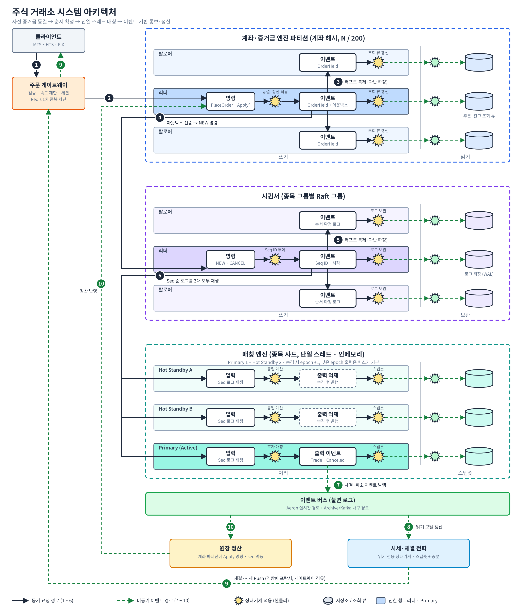

# 주식 거래소 시스템 설계

> 주문을 받자마자 자산을 먼저 묶고, 한 곳에서 순서를 정해 메모리에서 체결한 뒤, 정산은 나중에 비동기로 처리하는 구조다.

## 1. 도메인 배경 및 핵심 개념

주식 거래소는 매수·매도 주문을 종목별 호가창(미체결 주문 목록)에 모아 **가격 우선, 같은 가격이면 시간 우선**으로 체결한다. 체결이 한 건이라도 틀리면 돈과 주식이 어긋나기 때문에 빠르면서도 정확해야 한다.

**설계에 쓰는 핵심 개념**

| 개념 | 설명 | 이 설계에서 쓰는 곳 |
|---|---|---|
| Raft (합의 복제) | 데이터를 서버 3대에 복제하고, 과반(2대)이 저장하면 확정한다. 리더가 죽으면 나머지가 새 리더를 뽑는다 | 계좌 파티션, 시퀀서 로그 |
| 샤딩 | 데이터를 계좌나 종목 같은 기준으로 나눠 여러 서버가 분담한다 | 계좌 200개 파티션, 종목별 매칭 |
| 시퀀서 | 모든 요청에 증가하는 번호를 붙여 처리 순서를 한 곳에서 확정한다 | 주문·취소 순서 확정 |
| 이벤트 소싱 | 현재 상태 대신 변경 이력을 순서대로 저장하고, 재생해서 상태를 복원한다 | 주문 로그, 체결 이벤트, 감사 재현 |
| 인메모리 단일 스레드 처리 | 한 스레드가 메모리에서 순서대로 처리해서 락 경합이 없고 결과가 항상 같다 | 매칭 엔진 |
| WAL (Write-Ahead Log) | 변경을 디스크에 순차 기록한 뒤 메모리에 반영해서 재시작해도 복구된다 | 계좌 엔진 |
| 트랜잭셔널 아웃박스 | 상태 변경과 "다음에 보낼 메시지"를 한 번에 저장해서 장애 후에도 이어서 보낸다 | 계좌 엔진 → 시퀀서 전달 |
| 멱등성 | 같은 요청이 여러 번 와도 결과는 한 번 처리한 것과 같다 | 중복 주문 방지, 정산 중복 방지 |
| Hot Standby + epoch 펜싱 | 대기 서버가 같은 상태를 유지하다가 승격된다. 승격 때 세대 번호(epoch)를 올려 옛 서버의 출력은 무시한다 | 매칭 엔진 장애 조치 |
| CQRS | 쓰기(매칭)와 읽기(시세 조회)를 분리해서 읽기 부하가 쓰기에 영향을 주지 않게 한다 | 시세·체결 전파 서버 |

**핵심 아이디어는 세 가지다.**
1. **자산을 먼저 묶는다.** 체결할 때 잔고를 검사하거나 계좌 간 분산 트랜잭션을 할 필요가 없다.
2. **순서는 한 곳에서 정한다.** 시퀀서의 번호가 체결 우선순위의 유일한 기준이다.
3. **결과는 이벤트로 남긴다.** 통보, 시세, 정산, 감사가 모두 같은 이벤트를 읽는다.

## 2. 요구사항 및 설계 범위

**기능적 요구사항**
- 주문 접수 시 자산 동결 (잔고가 모자라면 거절)
- 가격·시간 우선 매칭, 부분 체결
- 미체결 주문 취소
- 체결 결과와 시세 실시간 푸시
- 체결 후 계좌 잔고 정산, 감사를 위한 재현

**비기능적 요구사항**

| 항목 | 목표 |
|---|---|
| 처리량 | 평시 50,000 TPS, 피크 500,000 TPS |
| 응답 지연 | 접수→체결 통보 10ms 이내 (엔진 내부 100µs) |
| 가용성 | 장 운영 중 99.99% (연 9.75분 이내 중단) |
| 내구성 | 확정된 주문은 유실 없음 |
| 재현성 | 과거 상태를 100% 재현 |

**가정:** 현물 주식만, 단일 통화, 공매도 없음, 한 리전의 AZ 3개(AZ 간 지연 1ms 이하)

**제외:** 파생상품, 외부 예탁결제, 시가/종가 단일가 경매, 다중 리전 active-active

## 3. 아키텍처 설계도

실선(①~⑥)은 응답 시간에 포함되는 동기 경로, 점선(⑦~⑩)은 비동기 이벤트 경로다. 점선 박스 하나가 Raft로 복제되는 서버 그룹이고, 진한 행이 리더(또는 Primary)다.

### 구성 요소

| 구성 요소 | 하는 일 |
|---|---|
| 주문 게이트웨이 | 인증·형식 검사, 속도 제한, Redis로 중복 주문 1차 차단, 푸시 연결 유지 |
| 계좌·증거금 엔진 | 잔고 확인과 자산 동결, 정산 반영. 계좌 해시로 200개 파티션, 파티션마다 리더 1 + 팔로어 2 |
| 시퀀서 | 주문에 번호(Seq ID)와 시각을 붙여 처리 순서를 확정. 종목 그룹별 Raft 그룹 |
| 매칭 엔진 | 단일 스레드로 메모리 호가창에서 체결. Primary 1 + Hot Standby 2가 같은 로그를 재생 |
| 이벤트 버스 | 체결·취소 결과를 순서대로 남기는 불변 로그 |
| 시세·체결 전파 | 이벤트로 호가창·체결 내역을 만들어 클라이언트에 전달 |
| 원장 정산 | 체결·취소 이벤트를 계좌 잔고에 반영 |

### 단계별 설명

| 번호 | 단계 | 설명 |
|---|---|---|
| ① | 주문 요청 | 클라이언트가 주문(종목, 수량, 가격, `client_order_id`)을 게이트웨이로 보낸다. 게이트웨이는 인증과 속도 제한을 검사하고, 같은 주문이 다시 온 것이면 Redis로 먼저 걸러낸다 |
| ② | 계좌 파티션으로 전달 | 계좌 ID로 담당 파티션을 찾아 `PlaceOrder` 명령을 리더에 보낸다. 리더는 중복 주문인지, 잔고가 충분한지 확인한다 |
| ③ | 자산 동결과 복제 | 잔고가 충분하면 가용 자산을 동결 상태로 옮기고, 같은 변경을 팔로어 2대에 Raft로 복제한다. 과반(2대)이 저장하면 확정이다. 이때 "시퀀서로 보낼 주문"도 아웃박스에 함께 기록한다 |
| ④ | 시퀀서로 전송 | 아웃박스의 주문을 시퀀서 리더에 `NEW` 명령으로 보낸다. 전송 전에 서버가 죽어도 아웃박스가 남아 있어서 다시 보내고, 시퀀서는 `order_id`로 중복을 걸러낸다 |
| ⑤ | 순서 확정 | 시퀀서가 주문에 Seq ID와 시각을 붙이고 팔로어에 Raft로 복제한다. 이 번호가 체결 우선순위의 기준이다 |
| ⑥ | 매칭 | Primary와 Hot Standby 2대가 같은 로그를 같은 순서로 읽어 메모리 호가창을 갱신한다. 체결 결과는 Primary만 내보내고, Standby는 계산만 하다가 Primary가 죽으면 승격한다 |
| ⑦ | 결과 이벤트 발행 | Primary가 체결·취소 결과를 이벤트 버스에 기록한다. 이 시점부터 확정된 사실이다 |
| ⑧ | 시세 읽기 모델 갱신 | 시세·체결 전파 서버가 이벤트로 호가창 뷰와 체결 내역을 만든다 |
| ⑨ | 클라이언트에 푸시 | 게이트웨이를 거쳐 체결 통보와 시세를 클라이언트에 밀어 준다 |
| ⑩ | 정산 | 정산이 이벤트를 계좌 파티션에 `Apply` 명령으로 넣는다. 체결분은 동결을 소비하고 가격 개선분을 환급하며 주식을 반영하고, 취소분은 동결을 해제한다. 같은 이벤트가 다시 와도 한 번만 적용한다 |

**예시: 삼성전자(1주 180,000원). A가 100주를 180,000원에 매수 주문하고, B가 30주를 178,000원에 매도 주문해 둔 상태 (단위: 원)**

| 단계 | A 가용 현금 | A 동결 현금 | A 주식 | B 가용 현금 |
|---|---:|---:|---:|---:|
| 시작 | 30,000,000 | 0 | 0 | 0 |
| 매수 주문 접수 (100 × 180,000 동결) | 12,000,000 | 18,000,000 | 0 | 0 |
| 30주 @178,000 체결, 정산 반영 | 12,060,000 | 12,600,000 | 30 | 5,340,000 |
| 남은 70주 취소 | 24,660,000 | 0 | 30 | 5,340,000 |

체결가는 호가창에 있던 주문의 가격(178,000원)이라, 30주 몫으로 묶어 둔 5,400,000원 중 60,000원이 돌아온다. A가 쓴 현금(30,000,000 − 24,660,000 = 5,340,000원)과 B가 받은 현금은 같다.

**장애가 나면**
- 매칭 엔진이 죽으면 대기 서버가 1초 안에 이어받는다. 이때 세대 번호(epoch)를 올려서 옛 서버의 출력은 무시한다.
- 계좌 파티션이나 시퀀서 리더가 죽으면 다른 복제본이 리더가 된다(0.3~0.5초). 영향은 해당 파티션에만 미친다.
- 취소와 체결이 동시에 오면 시퀀서 번호 순으로 처리한다. 이미 체결됐다면 취소는 거절되고, 동결 해제는 매칭 엔진이 취소를 확정한 경우에만 일어난다.

## 4. 기술 선택 근거

| 선택 | 요구사항 | 해결하는 문제 |
|---|---|---|
| 사전 증거금 동결 | 500,000 TPS, 10ms | 체결 때 두 계좌를 함께 바꾸는 분산 트랜잭션이 필요 없다 |
| Raft 3중 복제 | 99.99%, 주문 유실 없음 | 리더가 죽어도 확정된 주문이 남고 자동으로 복구된다 |
| 시퀀서 + 로그 복제 | 공정한 순서, 재현성 | 순서를 한 곳에서 정하고, 같은 로그로 몇 대든 같은 호가창을 만든다 |
| 단일 스레드 인메모리 매칭 | 엔진 내부 100µs | 락 경합이 없고 로그 순서대로 실행되어 결과가 항상 같다 |
| 대기 서버 + epoch | 1초 이내 장애 복구 | 대기 서버가 미리 같은 상태를 유지해서 승격에 복구 작업이 필요 없다 |
| 종목별·계좌별 샤딩 | 피크 처리량, 격리 | 한 종목이나 한 파티션의 쏠림이 전체로 번지지 않는다 |
| 이벤트 소싱 | 100% 재현, 감사 | 로그만 다시 재생하면 어느 시점의 상태도 만들 수 있다 |
| 읽기 전용 시세 서버 | 실시간 통보 | 구독자가 늘어도 매칭 엔진 부하는 변하지 않는다 |

## 5. 트레이드오프

| 선택 | 얻는 것 | 감수하는 것 | 검토한 대안 |
|---|---|---|---|
| 사전 동결 | 분산 트랜잭션 제거, 정산 실패 없음 | 주문마다 복제 대기(약 2ms), 주문 중 자금이 묶임 | 체결 때 검증 + 2PC·Saga: 느리고 복잡해서 제외 |
| 비동기 정산 | 원장 쓰기가 매칭 속도에 영향 없음 | 체결 후 수 ms 동안 잔고 반영이 늦음 | 매칭 때 동기 반영: 엔진이 느려짐 |
| 단일 스레드 매칭 | 빠르고 결과가 일정함 | 한 종목 처리량이 코어 하나에 묶임 | 멀티스레드 + 락: 순서 공정성이 깨질 위험 |
| Raft 3중 복제 | 장애 시에도 주문 유실 없음 | 서버 비용 3배, 쓰기마다 AZ 왕복 시간 | 비동기 복제: 장애 때 주문 유실 가능 |
| 이벤트 소싱 | 어느 시점이든 재현 | 로그 저장 비용(하루 약 117GB), 이벤트 형식 변경 관리 | 스냅숏만 저장: 감사 근거 부족 |

**운영 비용:** 정산 지연과 장애 조치 모니터링, 매일 로그를 재생해서 결과를 비교하는 별도 클러스터, 정기적인 장애 주입 테스트가 필요하다.
