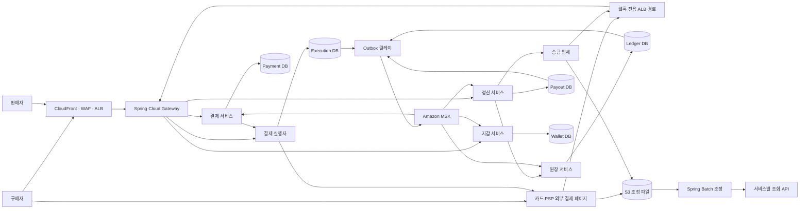

# 결제 시스템 설계

[4주차 결제 시스템 설계 발표 자료](https://github.com/cloud-club/10th-system-design-study/pull/8)와 『가상 면접 사례로 배우는 대규모 시스템 설계 기초 2』 11장을 바탕으로 설계했습니다.

## 1. 도메인 배경 및 핵심 개념

- **대금 수신(pay-in)**은 구매자의 카드로 결제하고 플랫폼이 판매자를 대신해 대금을 받는 과정입니다. 카드 승인, 매입 확정, PSP의 플랫폼 계좌 입금은 서로 다른 시점에 발생할 수 있습니다.
- **대금 정산(pay-out)**은 플랫폼이 정산 가능한 판매 대금을 판매자의 은행 계좌로 송금하는 과정입니다. 이 문서에서는 PSP가 플랫폼에 돈을 입금하는 단계를 *PSP 입금*이라고 부릅니다.
- **원장**은 자금 이동을 복식부기로 기록하고 판매자의 정산 가능 잔액을 관리합니다. **지갑**은 원장에서 받은 잔액을 판매자 화면에 보여줍니다.
- **조정(reconciliation)**은 외부 결제·송금 기록과 내부 결제·원장·지갑 기록을 대조해 누락, 지연, 금액 차이를 찾아내는 작업입니다.

## 2. 요구사항 및 설계 범위

| ID | 발표 요구사항 | 설계에서 다루는 부분 |
| --- | --- | --- |
| F1 | 구매자 대금 수신 | 외부 결제 페이지, PSP 웹훅·조회, 판매자별 결제 배분 |
| F2 | 판매자 대금 정산 | 정산 가능 잔액 확보, 송금 결과 확인, 실패 시 잔액 복원 |
| N1 | 신뢰성 및 내결함성 | 업무 키 멱등성, Outbox, 결과 미확정 상태, 재시도·DLT |
| N2 | 내부 기록과 PSP 정산 파일 조정 | 거래별 금액·상태 대조, 차이 분류·재처리 |
| N3 | 신용 카드 정보 보호 | PSP 외부 결제 페이지, 웹훅 검증, 민감 정보 저장 차단 |
| N4 | 유량 제어 | Gateway 요청 제한, PSP 호출량·동시성 제한 |
| N5 | 장애 격리 | PSP별 타임아웃·서킷 브레이커, 호출 경로와 조회 경로 분리 |
| N6 | 결제·환불 이력 추적 | 상태 이력, 실패 사유, `event_id`·`trace_id` |
| N7 | 모니터링 및 경보 | 성공률·지연·적체·미확정 거래·조정 차이 알림 |

- 전자상거래 카드 결제, 단일 통화, 하루 결제 100만 건을 가정합니다. 평균은 약 11.6 TPS입니다. 10배인 약 116 TPS는 초기 피크 부하 테스트 가정이며, PSP 호출 한도와 결제 한 건당 판매자 배분 수는 별도로 확인합니다.
- 구매자는 여러 판매자 상품을 한 번에 결제할 수 있습니다. 결제는 `checkout_id`당 한 번 실행하고, 판매자별 `payment_order_id`는 매출 배분 단위로 사용합니다. 판매자별 금액 합계는 PSP가 확정한 결제액과 일치해야 합니다.
- 예시 통화는 KRW입니다. 금액은 API에서 문자열로 전달하고, DB에는 통화의 최소 단위 정수로 저장합니다. 예시에서는 수수료를 생략합니다. 운영에서는 총액·수수료·실입금액을 별도 필드로 대조하고 수수료 부담 주체를 계약으로 정합니다.
- 운영상 환불 이력을 남길 수 있도록 정산 가능 전 전액 환불을 포함합니다. 부분 환불, 지급 가능 이후 환불·차지백, 다중 통화는 확장 과제로 둡니다. PSP와 송금 업체는 안정적인 거래 참조값, 상태 조회, 쓰기 API의 멱등 키를 제공한다고 가정합니다.

## 3. 아키텍처 설계도

서비스는 ECS Fargate에서 실행하고, 쓰기 DB는 서비스별 Aurora PostgreSQL로 둡니다. 실행자·정산·원장은 각자의 DB에서 상태 변경과 Outbox 저장을 한 트랜잭션으로 커밋합니다. 릴레이가 Kafka에 발행하고, 소비자는 처리한 이벤트와 업무 상태를 같은 DB 트랜잭션에 반영합니다.

### 데이터 소유권과 상태

| 서비스 | 소유 데이터와 판단 |
| --- | --- |
| 결제 | `checkout`, 판매자별 `payment_order`, 주문 조회 상태. 고객의 재요청은 `buyer_id + idempotency_key`로 식별하고, 같은 키에 요청 내용이 다르면 `409`를 반환합니다. |
| 결제 실행자 | `payment_execution`, `refund_execution`, 외부 거래 ID와 멱등 키, 상태 이력. PSP 결과는 실행자가 확정하고 결제 서비스에 전달합니다. |
| 원장 | `journal`, `journal_entry`, 판매자·통화별 `merchant_balance`, `payout_reservation`. 분개는 추가만 허용하고 정정은 반대 분개로 남깁니다. |
| 정산 | `payout`, 판매자별 요청 멱등 키, 송금 업체 참조값, 상태 이력. 원장에서 잔액을 확보한 건만 송금합니다. |
| 지갑 | `merchant_balance_view`. 원장 이벤트의 잔액 스냅샷과 버전을 저장하고 최신 버전만 반영합니다. |
| 조정 | `reconciliation_run`, `reconciliation_case`. 파일 버전, 기준 시점, 불일치와 조치 이력을 기록합니다. |

### 대금 수신

1. `POST /checkouts`에서 서버가 장바구니 가격을 확정하고, `checkout_id`와 판매자별 배분 내역을 저장합니다. 재요청은 기존 결제를 반환합니다.
2. 결제 실행자는 `checkout_id`로 PSP 요청과 멱등 키를 먼저 저장한 후 결제를 등록합니다. 정상 응답 시 외부 결제 페이지 URL을 반환합니다. 등록 결과가 불명확하면 `202`와 조회 경로를 반환하고, 워커가 기존 참조값으로 확인합니다. 구매자는 PSP 페이지에 카드 정보를 입력합니다.
3. 브라우저가 돌아오면 `GET /checkouts/{id}`로 상태를 표시합니다. 실행자는 웹훅의 서명·거래 ID·금액·통화를 검증하고, 수신 기록을 저장한 뒤 응답합니다. 웹훅 누락이나 호출 타임아웃으로 오래 대기하는 건만 조회 워커가 확인합니다. 승인 후 매입까지 완료되면 `CAPTURED`, 최종 거절·만료가 확인되면 `FAILED`로 전이합니다. 3D 인증 중이거나 결과를 모르면 `PENDING`을 유지합니다.
4. 실행자는 상태 변경과 `PaymentCaptured`를 같이 커밋합니다. 결제 서비스는 주문 상태를 갱신하고, 원장은 배분별 판매자 매출을 **정산 대기** 잔액으로 기록합니다. PSP 입금이 파일과 입금 증빙에서 확인된 뒤 **정산 가능** 잔액으로 옮깁니다.
5. 정산 가능으로 전환되기 전에 전액 환불을 요청하면 원장이 `checkout_id` 단위로 환불 보류를 먼저 기록한 뒤 실행자가 고정된 환불 키로 PSP를 호출합니다. 정산 가능 전환도 같은 결제 건을 잠가 처리합니다. 환불이 확정되면 판매자 정산 대기를 차감하고, PSP 입금 전후에 따라 미수금을 상계하거나 PSP에 반환할 금액을 기록합니다. 최종 실패하면 보류를 해제합니다. PSP 결과가 미확정인 동안에는 지급 가능 전환을 보류합니다.

### 판매자 대금 정산

1. 판매자가 `POST /payouts`로 요청하면 정산 서비스는 `payout_id`, 통화, 금액, 검증된 계좌의 지급 토큰을 저장합니다. 원장에 `payout_id`로 잔액 확보를 요청하고, 같은 ID의 재호출은 같은 확보 결과를 반환합니다. 원장 응답이 유실되면 다시 확인합니다.
2. 원장은 판매자·통화 잔액 행을 잠그고 잔액을 확인합니다. 충분하면 `payout_id`의 확보 기록과 분개를 저장하고 **정산 가능 → 지급 대기**로 잔액을 옮깁니다. 동시에 들어온 정산 요청도 같은 잔액 행에서 처리합니다.
3. 정산 서비스는 `payout_id`에 고정된 멱등 키로 송금 업체를 호출합니다. 응답이 끊기면 웹훅이나 조회로 결론을 얻을 때까지 지급 대기를 유지합니다. 접수 성공과 송금 완료는 별도 상태입니다. 워커는 오래된 잔액 확보·송금 대기 건을 조회해 중간에 종료된 작업을 같은 `payout_id`로 이어갑니다.
4. 송금 완료가 확인되면 원장이 지급 대기를 차감하고 송금 완료를 기록합니다. 최종 실패가 확인되면 지급 대기 금액을 정산 가능 잔액으로 돌립니다. 중복 이벤트는 `payout_id`와 원장의 상태 전이로 걸러냅니다. 판매자에게는 업체 결과와 원장 반영이 끝난 뒤 최종 상태를 보여줍니다.

수수료를 생략한 30,000원 분개 예시입니다. 각 행의 차변과 대변 금액은 같습니다. 환불과 송금 완료·실패는 각 단계에서 분기하는 경우입니다.

| 시점 | 차변 | 대변 |
| --- | --- | --- |
| 매입 확정 | PSP 미수금 30,000 | 판매자 정산 대기 30,000 |
| PSP 입금 전 환불 확정 | 판매자 정산 대기 30,000 | PSP 미수금 30,000 |
| PSP 입금 | 플랫폼 예금 30,000 | PSP 미수금 30,000 |
| 지급 가능 전환 | 판매자 정산 대기 30,000 | 판매자 정산 가능 30,000 |
| 지급 요청 확보 | 판매자 정산 가능 30,000 | 판매자 지급 대기 30,000 |
| 송금 완료 | 판매자 지급 대기 30,000 | 플랫폼 예금 30,000 |
| 송금 실패 시 확보 해제 | 판매자 지급 대기 30,000 | 판매자 정산 가능 30,000 |

### 중복과 장애 복구

- **외부 호출** — 작업별 멱등 키를 호출 전에 저장합니다. 타임아웃 뒤에는 거래를 먼저 조회하고, 업체가 허용하는 기간 안에 같은 키·같은 요청으로만 재전송합니다. 멱등 보장 기간이 지났고 결과도 모르면 자동 송금·결제를 중단하고 조정으로 넘깁니다. 업체별 보장 범위는 연동 시 확인합니다. [Stripe 멱등 요청 예시](https://docs.stripe.com/api/idempotent_requests)
- **업무 처리** — 웹훅은 업체와 이벤트 ID로, 원장 분개는 업무 참조 ID와 분개 유형으로 중복을 막습니다. Kafka는 `event_id`를 유지해 재발행하고, 소비자는 DB 커밋 후 오프셋을 진행합니다. 순서가 바뀐 이벤트는 상태 전이와 버전으로 걸러내며, 선행 분개가 필요한 건은 재시도합니다. [AWS Transactional Outbox](https://docs.aws.amazon.com/prescriptive-guidance/latest/cloud-design-patterns/transactional-outbox.html)
- **재시도** — 연결 오류, 업체가 명시한 일시적 오류, 호출 제한은 지수 백오프와 지터로 재시도합니다. 카드 거절처럼 확정된 업무 결과는 상태로 기록합니다. 재시도 소진 시 DLT에 남기되 외부 결과가 미확정이면 거래는 `PENDING`으로 둡니다. 운영자는 외부 결과 확인 뒤 기존 업무 키로 재처리합니다. [Spring Kafka Non-Blocking Retries](https://docs.spring.io/spring-kafka/reference/retrytopic.html)

### 조정과 운영

- **거래 조정** — EventBridge Scheduler가 Spring Batch를 실행합니다. S3의 PSP 정산·송금 파일을 기준으로 업체 거래 ID, 통화, 거래 유형, 총액·수수료·순액, 상태를 내부 기록과 대조합니다. PSP 입금은 입금 내역과 묶음 ID로 확인합니다. 같은 영업일과 파일 버전의 기준 시점으로 비교하고, 아직 도착하지 않은 파일은 누락 거래 집계에서 제외해 별도 알림을 보냅니다.
- **내부 조정** — 결제 확정 건의 분개 유무와 판매자·통화별 원장 잔액 및 지갑의 같은 버전을 확인합니다. 누락 이벤트는 원 서비스에서 동일한 업무 키로 재처리합니다. 금액·통화 차이나 확인할 수 없는 송금은 재무 검토로 넘기고, 확정된 정정은 원장 API에서 승인 이력과 함께 반대 분개로 처리합니다.
- **유량 제어와 장애 격리** — Gateway와 Redis에서 구매자·판매자별 쓰기 요청을 제한하고 초과 시 `429`를 반환합니다. 검증된 웹훅 경로와 고객 조회에는 별도 예산을 둡니다. 외부 호출 워커는 업체별 동시성·호출량 제한과 Resilience4j 타임아웃·서킷 브레이커를 적용합니다. 정산·결제 호출이 지연되는 동안 회원의 상태 조회와 내부 원장 반영은 계속 처리합니다.
- **보안과 이력** — 카드번호와 CVV는 PSP 페이지에만 입력하고, 내부에는 외부 거래 ID와 필요한 토큰만 둡니다. 웹훅은 서명과 재전송을 검증하며, 판매자 API는 본인 거래만 조회하도록 인가합니다. 상태 이력에는 변경 전후 상태, 실패 코드, 업무 ID, `event_id`, `trace_id`, 발생 시각과 변경 주체를 기록합니다. 로그에서 토큰과 계좌 정보는 가립니다. [웹훅 서명·재전송 처리 예시](https://docs.stripe.com/webhooks)
- **모니터링** — CloudWatch에서 결제·송금 성공률, p95/p99, 업체별 타임아웃, Kafka 소비 지연, Outbox의 가장 오래된 미발행 건, 미확정 거래의 대기 시간, 조정 불일치 건수·금액을 봅니다. 초기 알림은 DLT에 금전 거래가 들어오거나 일별 조정이 예정된 시간 안에 끝나지 않을 때 울리도록 하고, 지연과 성공률 기준은 부하 테스트와 운영 기준선을 확인해 정합니다.

## 4. 기술 선택 근거

| 선택 | 근거 |
| --- | --- |
| Spring Cloud Gateway · ECS Fargate | 결제 쓰기와 웹훅 정책을 경로별로 두고, 조회 API와 외부 호출 워커의 배포 및 확장 단위를 나눕니다. |
| Aurora PostgreSQL | 업무 키 고유 제약으로 중복 요청을 제어하고, 판매자별 잔액 확보와 복식부기 분개를 함께 커밋합니다. [PostgreSQL 행 잠금](https://www.postgresql.org/docs/18/explicit-locking.html) |
| Outbox · Amazon MSK | PG 응답을 확정한 서비스가 상태와 이벤트를 함께 기록하고, 주문·원장이 자기 처리 속도에 맞춰 이벤트를 소비합니다. |
| Redis · Resilience4j | 출입구의 요청 제한과 외부 호출 경로의 동시성·장애 차단을 별도로 적용합니다. |
| S3 · EventBridge Scheduler · Spring Batch · CloudWatch | 일별 대조 자료를 다시 읽을 수 있게 보관하고, 파일 단위 재실행과 미처리 건 경보를 지원합니다. |

## 5. 트레이드오프

- **원장에서 잔액 확보** — 분개와 잔액 확보를 한 트랜잭션에서 처리할 수 있습니다. 그만큼 정산은 원장 쓰기 경로에 의존하고 판매자 한 곳에 요청이 몰리면 행 잠금 경합이 생깁니다. 지갑에서 잔액을 확보하는 대안은 지갑에서 즉시 응답할 수 있지만, 원장 기록이 밀렸을 때 두 상태를 대조하고 복구하는 절차가 추가됩니다.
- **지갑 조회 모델** — 판매자 조회가 원장 DB에 몰리는 것을 줄이는 대신 잔액이 늦게 표시될 수 있습니다. 지갑은 반영 시각을 보여주고, 송금을 승인할 때는 원장 잔액을 확인합니다.
- **서비스별 DB와 Kafka** — 결제·정산·원장의 장애를 격리하기 쉽지만, 원장 반영 지연과 이벤트 재처리 비용이 생깁니다. 하루 100만 건이라는 가정만 놓고 보면 단일 DB와 작업 큐도 가능하고, 그 경우 주문과 원장을 함께 커밋할 수 있습니다. 이번 설계에서는 발표의 서비스 경계를 유지해 분산 장애와 복구를 검토했습니다.
- **미확정 거래 보류** — 결과를 확인한 뒤 처리해 중복 인출 위험을 줄이는 대신, 외부 장애가 길면 고객의 주문이나 판매자 잔액이 오래 대기할 수 있습니다. 오래된 건부터 조정·수동 조사 대상으로 올립니다.

## 6. 설계 검증 시나리오

| 상황 | 확인할 결과 |
| --- | --- |
| 결제 버튼 중복 클릭과 PSP 승인 응답 유실 | PSP 결제 한 건, 동일한 `checkout_id`, 판매자별 분개 한 번 |
| 웹훅이 늦거나 Kafka 이벤트가 중복·역순 도착 | 조회로 결과 복구, 최종 상태 유지, 분개 중복 없음 |
| 잔액 30,000원에서 20,000원 정산이 동시에 두 건 | 한 건만 확보되고 지급 가능 잔액이 음수가 되지 않음 |
| 송금 성공 후 응답 유실 | 지급 대기를 유지하다 조회로 확정, 동일 건 재송금 없음 |
| PSP 파일과 내부 금액 불일치 | 조정 건 생성, 차이가 해소될 때까지 해당 매출의 지급 가능 전환 보류 |

위 내용은 설계 검증에 사용할 시나리오입니다. 피크 처리량과 PSP·송금 업체별 조회 및 멱등 보장 범위는 연동 검증 항목으로 남겼습니다.
