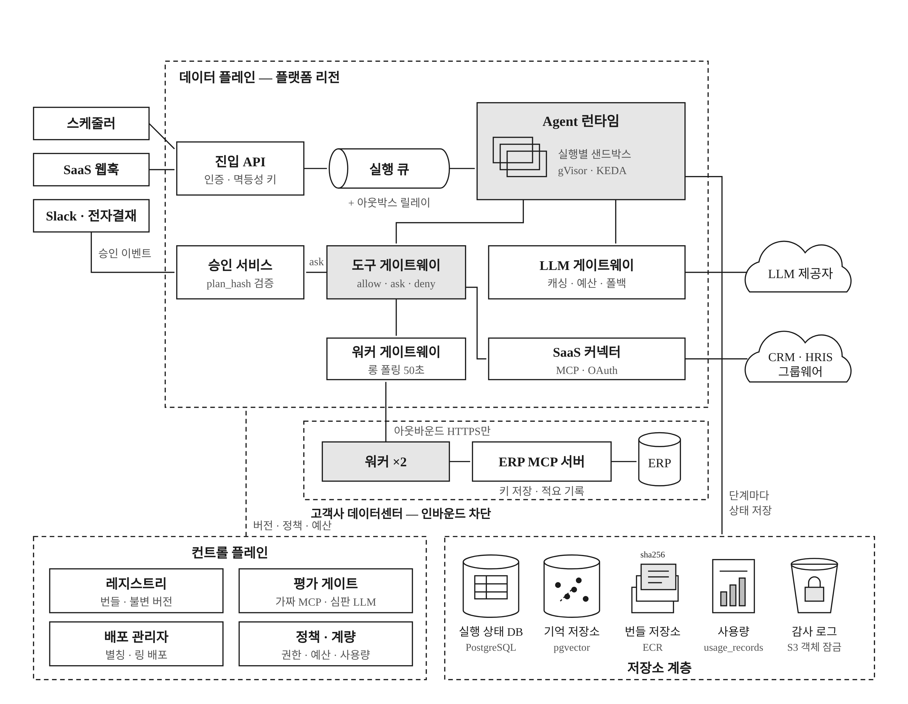
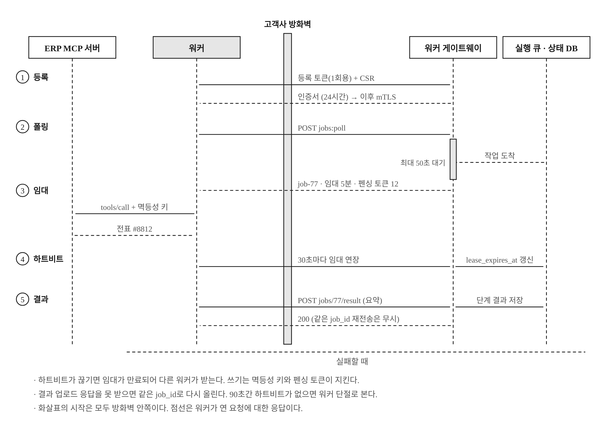

# 🏗️ B2B Agent 배포·서빙 플랫폼 설계

## 1. 도메인 배경 및 핵심 개념

**발표 자료**

[도구 활용 Agent 배포·서빙 플랫폼 설계 발표 자료](https://cloud-club.github.io/10th-system-design-study/week05/presentation/%EB%8F%84%EA%B5%AC%20%ED%99%9C%EC%9A%A9%20Agent%20%EB%B0%B0%ED%8F%AC%C2%B7%EC%84%9C%EB%B9%99%20%ED%94%8C%EB%9E%AB%ED%8F%BC%20%EC%84%A4%EA%B3%84%20-%20%EC%9D%B4%EC%A0%95%EC%9D%B8.html) · [GitHub 원본](https://github.com/cloud-club/10th-system-design-study/blob/main/week05/presentation/%EB%8F%84%EA%B5%AC%20%ED%99%9C%EC%9A%A9%20Agent%20%EB%B0%B0%ED%8F%AC%C2%B7%EC%84%9C%EB%B9%99%20%ED%94%8C%EB%9E%AB%ED%8F%BC%20%EC%84%A4%EA%B3%84%20-%20%EC%9D%B4%EC%A0%95%EC%9D%B8.html)

**설계 대상**

중견기업 300곳에 매출관리 서비스를 제공하는 가상의 B2B SaaS 회사가, 사내 팀이 만든 Agent를 고객사별로 배포하고 실행하는 플랫폼입니다. 첫 사용 사례는 **매출 마감 Agent**입니다. 월말에 CRM 계약 금액과 ERP 매출 전표가 맞는지 확인하고, 틀리면 근거를 찾아 수정 전표를 올립니다.

**핵심 개념**

- **Agent 서빙:** LLM이 다음 행동을 고르고 도구를 호출하는 실행을 받아서, 격리된 환경에서 돌리고, 상태·권한·비용을 관리하는 일입니다. 실행 하나가 몇 분에서 몇 시간까지 이어질 수 있습니다.
- **MCP (Model Context Protocol):** Agent가 외부 시스템(CRM, ERP 등)의 기능을 도구로 호출하는 표준 프로토콜입니다. 이 설계에서는 SaaS 커넥터와 고객사 ERP 서버가 모두 MCP로 도구를 노출합니다.
- **불변 번들과 별칭:** Agent 한 버전은 컨테이너 이미지 다이제스트와 설정 파일(`agent.yaml`)의 묶음이며, 등록 후에는 바꿀 수 없습니다. 고객사는 `stable`·`canary` 같은 별칭으로 버전을 가리키고, 실행은 시작할 때의 버전에 고정됩니다.
- **멱등성 키:** 같은 쓰기 요청이 재시도로 여러 번 도착해도 결과가 한 번만 반영되도록 요청마다 붙이는 고유 키입니다.
- **원하는 상태와 맞춤 루프:** 컨트롤 플레인은 "어느 고객사에 어느 버전"이라는 원하는 상태만 기록하고, 각 셀의 컨트롤러가 주기적으로 현재 상태를 그에 맞춥니다.

## 2. 요구사항 및 설계 범위

**기능적 요구사항**

- **번들 등록:** 사내 팀은 Agent 번들(컨테이너 이미지와 설정 파일)을 등록할 수 있으며, 등록된 버전은 수정할 수 없습니다.
- **평가 후 배포:** 새 버전은 평가 세트(과거 마감 240건)를 통과한 뒤에만 배포할 수 있습니다.
- **단계적 배포와 롤백:** 운영자는 고객사별로 Agent 버전을 지정하고, 일부 고객사에 먼저 내보낸 뒤 넓힐 수 있습니다. 문제가 생기면 1분 안에 이전 버전으로 되돌립니다.
- **실행 트리거와 조회:** Agent는 스케줄, SaaS 웹훅, Slack 요청으로 실행되며, 사용자는 진행 상황을 조회할 수 있습니다.
- **권한과 승인:** Agent마다 신원과 도구 권한이 주어지고, 장부에 반영되는 쓰기는 사람이 승인한 뒤에만 실행됩니다.
- **사용량과 예산:** 고객사·Agent·버전별로 토큰과 실행 시간을 집계하고, 예산을 넘으면 새 실행을 막습니다.

**비기능적 요구사항**

- **테넌트 격리:** 한 고객사의 데이터, 기억, 권한이 다른 고객사의 실행에 섞이지 않아야 합니다.
- **고객사 망 보호:** 고객사 데이터센터에는 밖으로 나가는 HTTPS(443) 연결만 허용하고, 연결이 끊기면 90초 안에 감지합니다.
- **응답 지연:** 실행 접수는 P95 1초 이하, 첫 진행 알림은 5초 이내입니다. 전체 실행 시간은 LLM과 도구 속도에 달려 있어 목표에서 제외합니다.
- **가용성과 내구성:** 실행 접수 API는 99.9% 가용성을 목표로 합니다. 승인을 몇 시간 기다리거나 플랫폼을 재배포해도 실행이 이어지고, 런타임 장애 후 60초 안에 재개를 시작합니다.
- **데이터 정확성:** 같은 전표가 두 번 등록되거나 같은 사용량이 두 번 청구되지 않아야 합니다.
- **비용 통제:** 동시 실행이 몰려도 예산 초과분은 "동시 실행 수 × LLM 호출 한 번 분량" 이내로 제한합니다.
- **감사 가능성:** 누가, 어떤 버전으로, 어떤 도구를, 누구의 승인으로 실행했는지 감사 기간 동안 재구성할 수 있어야 합니다.

**추가 가정 및 제외 범위**

- **규모 가정:** 고객사 300곳, Agent 20종, 평일 오전 질의 피크 1,000건, 월말 마감 실행 3,000건을 가정합니다. 샌드박스 하나는 0.5 vCPU · 1GiB로 잡습니다.
- **고객사 환경:** 일부 고객사는 ERP를 자체 데이터센터에서 운영하며, 인바운드 포트를 열 수 없습니다.
- **제외 범위:** Agent 자체의 프롬프트·모델 품질 개선, LLM 게이트웨이 내부 설계(라우팅·캐싱), 고객사 ERP 구현은 범위에서 제외합니다.

## 3. 아키텍처 설계도

**최종 아키텍처**

**매출 마감 실행 흐름**

- **실행 접수 (①–②):** 07:00 스케줄러가 진입 API를 호출하면, 실행 레코드와 아웃박스 행이 한 트랜잭션으로 저장되고 릴레이가 실행 큐에 넣습니다.
- **판단과 조회 (③–⑤):** 실행별 샌드박스에서 Agent가 시작해 LLM 게이트웨이로 판단하고, 도구 게이트웨이를 거쳐 CRM은 SaaS 커넥터로, ERP는 워커로 조회합니다.
- **승인 대기 (⑥–⑦):** 수정 전표 등록은 도구 게이트웨이가 `ask`로 막고 승인 서비스에 넘깁니다. 실행 상태와 작업 메모는 상태 DB에 저장되고 샌드박스는 반납됩니다.
- **재개와 등록 (⑧–⑨):** 전자결재 승인이 오면 승인 서비스가 `plan_hash`를 검증하고 실행을 다시 큐에 넣습니다. 워커가 멱등성 키와 함께 ERP MCP 서버에 전표를 등록합니다.
- **기록 (⑩):** 모든 단계의 사용량과 감사 로그가 저장소 계층에 남습니다.

**워커 프로토콜**

**설계 설명**

- **컨트롤 플레인과 데이터 플레인 분리:** 레지스트리, 평가 게이트, 배포 관리자, 정책·계량은 컨트롤 플레인에 둡니다. 실행 경로(진입 API, 큐, 런타임, 게이트웨이)는 데이터 플레인에 두어, 컨트롤 플레인이 멈춰도 이미 배포된 버전의 실행은 계속됩니다.
- **워커 아웃바운드 롱 폴링:** 고객사 워커 2대가 mTLS로 등록한 뒤 최대 50초짜리 롱 폴링으로 작업을 받습니다. 작업은 5분 임대와 펜싱 토큰을 달고 나가며, 30초 하트비트로 임대를 연장합니다. 결과는 `job_id`로 중복 제거합니다.
- **도구 게이트웨이:** 모든 도구 호출을 `allow`·`ask`·`deny`로 판정합니다. 권한은 읽기 / 초안 쓰기 / 장부 반영 쓰기 / 금지 네 단계로 나눕니다.
- **실행 상태 기계:** `QUEUED → RUNNING → WAITING_TOOL / WAITING_APPROVAL → COMPLETED / FAILED / ESCALATED`로 상태를 관리하고, 전이는 조건부 UPDATE로만 일어납니다. 승인 대기 중에는 샌드박스를 잡지 않습니다.
- **정확히 한 번 등록:** ERP MCP 서버가 멱등성 키를 UNIQUE 제약으로 먼저 선점한 뒤 전표를 등록하고, 키를 전표 적요에도 기록합니다. 응답이 사라진 채 결과를 확인할 수 없으면 재시도하지 않고 `ESCALATED`로 사람에게 넘깁니다.
- **링 배포:** 자사 시험 테넌트(1일) → 자원 고객사 2곳(3일) → 전체 순서로 별칭을 옮깁니다. 각 셀의 컨트롤러가 30초마다 원하는 상태를 당겨 와 맞추고, 연결이 끊겨도 읽기는 계속하되 새 쓰기는 막습니다.

## 4. 기술 선택 근거

- **Amazon SQS + 트랜잭셔널 아웃박스:** 월말 마감 폭주를 큐로 흡수합니다. 실행 레코드와 아웃박스 행을 한 트랜잭션에 쓰므로, DB에는 있는데 큐에는 없는 실행이 생기지 않습니다.
- **Amazon EKS + gVisor + KEDA:** 실행마다 샌드박스를 띄워 고객사 간 격리를 지키고, 큐 길이 기준으로 0개까지 줄였다가 피크에 약 1,300개(노드 약 60대)까지 늘립니다.
- **PostgreSQL (행 수준 보안):** 상태 전이를 조건부 UPDATE로 처리하고, 단계 결과와 상태를 한 트랜잭션에 묶습니다. 피크 쓰기가 초당 약 120건이라 주 1대와 읽기 복제본으로 충분합니다.
- **pgvector:** Agent 기억을 같은 PostgreSQL에 두고 `tenant_id`로 먼저 거른 뒤 검색해, 별도 벡터 DB 없이 테넌트 격리를 유지합니다.
- **Amazon ECR (다이제스트, amd64·arm64):** 이미지 다이제스트로 버전을 고정하고, 고객사 안의 arm64 장비에서도 같은 번들을 실행합니다.
- **LLM 게이트웨이 → Claude API · Amazon Bedrock:** 프롬프트 캐싱, 고객사별 토큰 예산, 공급자 장애 시 대체 모델을 한곳에서 처리합니다.
- **MCP + 워커 롱 폴링:** SaaS는 클라우드에서 MCP로 연결하고, 온프레미스 ERP는 고객사 인바운드 포트 없이 워커가 바깥으로 연결해 작업을 받아 갑니다.
- **Amazon S3 객체 잠금:** 감사 로그를 수정·삭제할 수 없게 보관합니다.
- **OpenTelemetry:** 실행 하나를 trace 하나로 묶어 LLM 호출, 도구 호출, 승인 대기를 한 화면에서 추적합니다.

## 5. 트레이드오프

- **불변 번들과 핫패치:** 프롬프트 문구 하나를 바꿔도 새 버전을 만들고 평가를 다시 돌려야 합니다. 대신 어떤 실행이 어떤 버전으로 돌았는지 항상 재현할 수 있습니다.
- **실행별 버전 고정:** 배포 중에도 진행 중인 실행이 버전을 바꾸지 않지만, 이전 버전 이미지를 한동안 유지해야 합니다.
- **고객사 단위 링과 요청 비율 분할:** 고객사 단위로 내보내면 한 고객사의 결과가 버전 간에 섞이지 않지만, 전체 적용까지 최소 4일이 걸립니다.
- **워커와 VPN·인바운드 API:** 고객사 방화벽을 열지 않아도 되지만, 워커 설치·인증서·업데이트(N-2 호환)를 플랫폼이 관리해야 합니다.
- **단계마다 저장 후 재개와 Temporal:** 구조가 단순하고 고객사 설치형 셀에서도 그대로 돌지만, 재개 로직을 직접 작성해야 하고 단계 중간 지점은 복원하지 못합니다. 워크플로가 복잡해지면 이벤트 기록·재생 방식으로 옮깁니다.
- **멱등성 키와 단순 재시도:** 전표 중복을 막지만, ERP MCP 서버가 키 저장과 적요 기록을 구현해야 하고 결과가 불명확한 실행은 사람이 확인해야 합니다.
- **`plan_hash`에 묶인 승인:** 승인한 계획과 다른 쓰기를 막지만, 재무팀 승인이 병목이 될 수 있습니다.
- **Bridge 격리 모델:** 공유 인프라 위에 실행별 샌드박스와 행 수준 보안으로 격리하므로 Silo보다 저렴하지만, 권한·정책 구성이 복잡해집니다.

## 6. 구현 및 설계 검증 (선택)

**용량 산정**

| 항목 | 값 | 설계에 주는 영향 |
| --- | --- | --- |
| 피크 샌드박스 | 약 1,300개 | 노드 약 60대(16 vCPU, 사용률 70%), 평시 10대 |
| 실행 상태 DB 쓰기 | 평균 초당 12, 피크 약 120 | PostgreSQL 주 1대 + 읽기 복제본, 샤딩 불필요 |
| 워커 연결 | 초당 약 13 요청 | 워커 게이트웨이 2대(이중화) |
| LLM 피크 토큰 | 분당 약 550만 | 게이트웨이에서 고객사별 한도 배분 |

이 규모에서는 대규모 샤딩보다 쓰기 정확성, 권한, 긴 실행의 상태 관리가 핵심 과제입니다.

## 7. 리뷰받고 싶은 부분 (선택)

- **카나리 단위:** 고객사 단위 링과 요청 비율 분할 중 어느 쪽이 맞을지, 고객사가 3곳이라면 답이 달라지는지 의견을 듣고 싶습니다.
- **자동 실행 범위:** 일정 금액 미만의 수정 전표는 승인 없이 등록해도 될지, 승인 부담과 오등록 위험을 어떻게 비교할지 궁금합니다.
- **관리형 서비스 경계:** AgentCore·Foundry 같은 관리형 서비스에 맡길 부분과 직접 만들어야 할 부분(워커, 승인, 계량)의 경계가 적절한지 봐 주세요.
